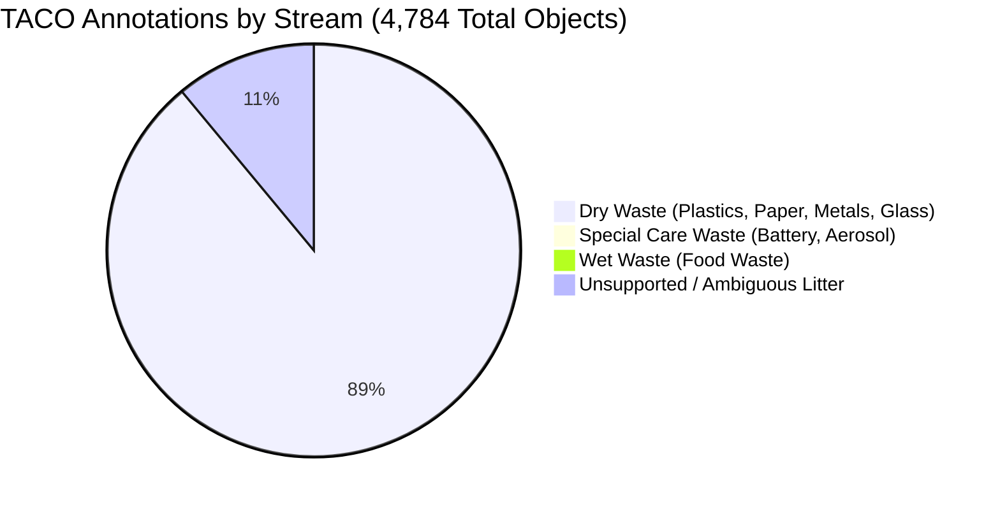
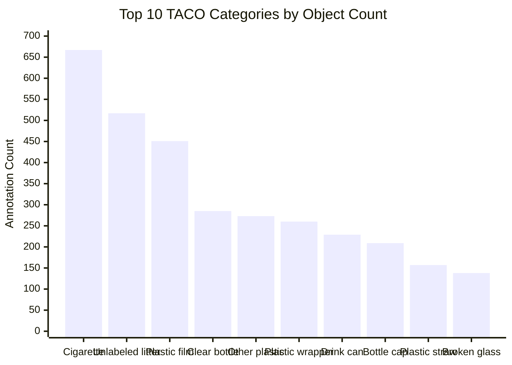

# TACO Dataset Inspection, Taxonomy Mapping & Coverage Report

**Project**: EcoSort AI — Multilingual, Multimodal Standalone Waste Segregation Kiosk  
**Competition**: Bharat AI-SoC Challenge 2026–27  
**Problem Statement**: PS-02 — Smart Recycling and Waste Segregation  
**Target Hardware**: Raspberry Pi 5 + AI HAT+ 2 (Hailo-8 / Hailo-8L NPU)  
**Document Version**: 1.0 (Task 5.2 Dataset Specification)  
**Original Dataset Source**: [TACO (Trash Annotations in Context)](https://github.com/pedropro/TACO) / [tacodataset.org](http://tacodataset.org/)

---

## 1. Executive Dataset Overview

TACO is an open-source, high-resolution dataset of litter images annotated under COCO object detection format. It was created by Pedro F. Proença and Pedro Simões (2020) to advance computer vision algorithms for automated litter detection and environmental monitoring.

### 1.1 Metadata and Provenance
- **Dataset Title**: TACO (Trash Annotations in Context)
- **Year / Release**: 2019–2020
- **License**: Creative Commons Attribution 4.0 International ([CC BY 4.0](https://creativecommons.org/licenses/by/4.0/))
- **Attribution**: *Proença, P.F. and Simões, P., 2020. TACO: Trash Annotations in Context for Litter Detection. arXiv preprint arXiv:2003.06975.*
- **Annotation Format**: Standard MS-COCO Object Detection (`info`, `images`, `annotations`, `categories`)
- **Annotation Types**: Axis-aligned Bounding Boxes (`[x, y, width, height]`), 2D Polygon Segmentations, Segment Area, Supercategories
- **Inspected Metadata File**: [`D:\EcoSort-Resources\datasets\TACO\annotations.json`](file:///D:/EcoSort-Resources/datasets/TACO/annotations.json) (2.85 MB)

---

## 2. Quantitative Annotation Distribution

Based on direct programmatic inspection of the official `annotations.json` file:

| Metric | Measured Value | Analysis & Implication for EcoSort AI |
| :--- | :--- | :--- |
| **Total Images** | **1,500** | Small-to-medium dataset, highly suitable for fast edge transfer learning. |
| **Total Annotated Objects** | **4,784** | Average of 3.19 objects per image across the dataset. |
| **Defined Categories** | **60** | Granular material and packaging categories. |
| **Defined Supercategories** | **28** | Higher-level material groupings (Bottle, Can, Carton, etc.). |
| **Images with $\ge 1$ Annotation** | **1,500** (100.0%) | Zero unannotated background images in current annotation release. |
| **Images with Exactly 1 Object** | **610** (40.7%) | Isolated object scenes (ideal for clean classification benchmarks). |
| **Images with Multiple Objects ($> 1$)** | **890** (59.3%) | Complex clutter scenes requiring spatial non-maximum suppression (NMS). |
| **Maximum Objects in One Image** | **90** | Dense accumulation scene (e.g., littered beach/street). |

---

## 3. Class Imbalance & Long-Tail Distribution

The TACO dataset exhibits acute class imbalance typical of crowd-sourced litter collections:

### 3.1 Distribution Tiers
1. **Dominant Head Categories ($> 200$ annotations)**:
   - `Cigarette`: 667 (13.94%)
   - `Unlabeled litter`: 517 (10.81%)
   - `Plastic film`: 451 (9.43%)
   - `Clear plastic bottle`: 285 (5.96%)
   - `Other plastic`: 273 (5.71%)
   - `Other plastic wrapper`: 260 (5.43%)
   - `Drink can`: 229 (4.79%)
   - `Plastic bottle cap`: 209 (4.37%)
2. **Moderate Mid-Tier Categories ($25–199$ annotations)**:
   - 24 categories (including `Broken glass`: 138, `Styrofoam piece`: 112, `Glass bottle`: 104, `Normal paper`: 82, `Single-use carrier bag`: 61, `Crisp packet`: 39, `Food Can`: 34).
3. **Severe Long-Tail Deficit Categories ($< 25$ annotations)**:
   - **26 categories** have fewer than 25 samples.
   - **18 categories** have fewer than 10 samples.
   - Critical examples:
     - `Food waste`: only **8** annotations (0.17%).
     - `Battery`: only **2** annotations (0.04%).
     - `Aluminium blister pack`: only **6** annotations.
     - `Plastified paper bag`: **0** annotations.

---

## 4. Comprehensive Taxonomy Mapping to EcoSort AI

EcoSort AI maps TACO's 60 categories to India's statutory **Solid Waste Management Rules, 2026** (Notification S.O. 388(E)) 4-stream taxonomy:

- **Direct Mappings**: 41 categories
- **Partial Mappings**: 14 categories (context-dependent)
- **Ambiguous Mappings**: 4 categories (requires visual verification)
- **Unsupported**: 1 category (`Unlabeled litter`)

| TACO ID | TACO Category Name | Supercategory | EcoSort Class ID | Primary Stream | Status | Statutory / Physical Evidence |
| :---: | :--- | :--- | :--- | :--- | :---: | :--- |
| **0** | Aluminium foil | Aluminium foil | `dry_metal_aluminium_cans` | **Dry waste** | Direct | Rule 3(s), 3(zw): Clean household aluminium foil is dry recyclable metal. |
| **1** | Battery | Battery | `special_batteries_household_dry_cell` | **Special care** | Direct | Rule 3(zy) & Battery Rules 2022: Hazardous dry cell battery. (2 samples) |
| **2** | Aluminium blister pack | Blister pack | `dry_plastic_mlp_non_recyclable` | **Dry waste** | Partial | Empty consumer packaging; if containing medicine -> Special care waste. |
| **3** | Carded blister pack | Blister pack | `dry_paper_cardboard_cartons` | **Dry waste** | Partial | Composite cardboard + plastic bubble; requires manual separation. |
| **4** | Other plastic bottle | Bottle | `dry_plastic_hdpe_containers` | **Dry waste** | Partial | Opaque rigid bottles (HDPE/PP Resin Code 2/5). |
| **5** | Clear plastic bottle | Bottle | `dry_plastic_pet_bottles` | **Dry waste** | Direct | Standard PET beverage bottles (Resin Code 1). |
| **6** | Glass bottle | Bottle | `dry_glass_bottles_jars` | **Dry waste** | Direct | Intact glass beverage/sauce bottles (100% recyclable). |
| **7** | Plastic bottle cap | Bottle cap | `dry_plastic_pp_containers` | **Dry waste** | Direct | Threaded caps are injection-molded PP (Resin Code 5) or HDPE. |
| **8** | Metal bottle cap | Bottle cap | `dry_metal_steel_tin_cans` | **Dry waste** | Direct | Crown corks and steel twist closures. |
| **9** | Broken glass | Broken glass | `dry_glass_broken_shards` | **Dry waste** | Direct | Glass shards; requires puncture-proof wrapping (Schedule II, Part A). |
| **10** | Food Can | Can | `dry_metal_steel_tin_cans` | **Dry waste** | Direct | Tin-plated steel food preservation cans. |
| **11** | Aerosol | Can | `pending_cosmetic_aerosols` | **Special care** | Partial | Pressurised canisters; potential explosion hazard upon compaction. |
| **12** | Drink can | Can | `dry_metal_aluminium_cans` | **Dry waste** | Direct | High-grade aluminium alloy beverage cans. |
| **13** | Toilet tube | Carton | `dry_paper_cardboard_cartons` | **Dry waste** | Direct | Paperboard roll cores (cellulose fiber). |
| **14** | Other carton | Carton | `dry_paper_cardboard_cartons` | **Dry waste** | Partial | Clean paperboard packaging. |
| **15** | Egg carton | Carton | `dry_paper_cardboard_cartons` | **Dry waste** | Direct | Molded pulp cellulose paper. |
| **16** | Drink carton | Carton | `dry_paper_tetra_packs` | **Dry waste** | Direct | Aseptic composite beverage carton (paperboard + PE + Al foil). |
| **17** | Corrugated carton | Carton | `dry_paper_cardboard_cartons` | **Dry waste** | Direct | High-yield corrugated cardboard shipping boxes. |
| **18** | Meal carton | Carton | `dry_paper_cardboard_cartons` | **Dry waste** | Partial | Clean box -> Dry; grease/sauce-soaked base -> Wet waste. |
| **19** | Pizza box | Carton | `dry_paper_cardboard_cartons` | **Dry waste** | Partial | Clean lid -> Dry; grease-saturated base -> Wet waste. |
| **20** | Paper cup | Cup | `dry_paper_cardboard_cartons` | **Dry waste** | Partial | Polyethylene-lined paper cup (composite paper). |
| **21** | Disposable plastic cup | Cup | `dry_plastic_pp_containers` | **Dry waste** | Direct | Polypropylene or PET beverage cup. |
| **22** | Foam cup | Cup | `dry_plastic_single_use_banned` | **Dry waste** | Direct | Thermocol (EPS) cup prohibited under PWM Amendment Rules 2021. |
| **23** | Glass cup | Cup | `dry_glass_bottles_jars` | **Dry waste** | Direct | Intact drinking glassware. |
| **24** | Other plastic cup | Cup | `dry_plastic_pp_containers` | **Dry waste** | Partial | Rigid plastic drinkware. |
| **25** | Food waste | Food waste | `wet_kitchen_food_scraps` | **Wet waste** | Direct | Rule 3(zzl): Discarded organic meal remnants (compostable). |
| **26** | Glass jar | Glass jar | `dry_glass_bottles_jars` | **Dry waste** | Direct | Preserves and condiment glass jars. |
| **27** | Plastic lid | Lid | `dry_plastic_pp_containers` | **Dry waste** | Direct | Rigid container lids (PP/PE). |
| **28** | Metal lid | Lid | `dry_metal_steel_tin_cans` | **Dry waste** | Direct | Jar twist-off metal lids. |
| **29** | Other plastic | Other plastic | `null` | **Unsupported** | Ambiguous | Catch-all with unknown polymer resin; cannot map reliably. |
| **30** | Magazine paper | Paper | `dry_paper_newspaper` | **Dry waste** | Direct | Glossy coated periodicals. |
| **31** | Tissues | Paper | `null` | **Unsupported** | Ambiguous | Sanitary vs compostable kitchen napkin cannot be resolved without context. |
| **32** | Wrapping paper | Paper | `dry_paper_newspaper` | **Dry waste** | Direct | Decorative cellulose wrapping paper. |
| **33** | Normal paper | Paper | `dry_paper_newspaper` | **Dry waste** | Direct | Office sheets, notebook pages, printouts. |
| **34** | Paper bag | Paper bag | `dry_paper_newspaper` | **Dry waste** | Direct | Kraft paper grocery bags. |
| **35** | Plastified paper bag | Paper bag | `dry_plastic_mlp_non_recyclable` | **Dry waste** | Partial | Polymer-laminated paper (0 samples in TACO). |
| **36** | Plastic film | Plastic bag & wrapper | `dry_plastic_ldpe_films` | **Dry waste** | Direct | LDPE stretch wrap and clean packaging film. |
| **37** | Six pack rings | Plastic bag & wrapper | `dry_plastic_ldpe_films` | **Dry waste** | Direct | Photodegradable LDPE can rings. |
| **38** | Garbage bag | Plastic bag & wrapper | `dry_plastic_ldpe_films` | **Dry waste** | Partial | Clean refuse sack -> Dry; full sack -> Depends on contents. |
| **39** | Other plastic wrapper | Plastic bag & wrapper | `dry_plastic_mlp_non_recyclable` | **Dry waste** | Partial | Metallised BOPP snack wraps -> RDF / co-processing. |
| **40** | Single-use carrier bag | Plastic bag & wrapper | `dry_plastic_single_use_banned` | **Dry waste** | Direct | Banned plastic carry bags (< 120 microns) per PWM Rules. |
| **41** | Polypropylene bag | Plastic bag & wrapper | `dry_plastic_pp_containers` | **Dry waste** | Direct | Woven PP grain / grocery sacks. |
| **42** | Crisp packet | Plastic bag & wrapper | `dry_plastic_mlp_non_recyclable` | **Dry waste** | Direct | Multi-layered plastic snack pouch (metallised foil). |
| **43** | Spread tub | Plastic container | `dry_plastic_pp_containers` | **Dry waste** | Direct | Margarine and butter polypropylene tubs. |
| **44** | Tupperware | Plastic container | `dry_plastic_pp_containers` | **Dry waste** | Direct | Polypropylene rigid reusable containers. |
| **45** | Disposable food container | Plastic container | `dry_plastic_pp_containers` | **Dry waste** | Direct | Takeaway plastic clamshell meal trays. |
| **46** | Foam food container | Plastic container | `dry_plastic_single_use_banned` | **Dry waste** | Direct | Banned expanded polystyrene clamshells. |
| **47** | Other plastic container | Plastic container | `dry_plastic_hdpe_containers` | **Dry waste** | Partial | Miscellaneous rigid plastic tubs. |
| **48** | Plastic glooves | Plastic glooves | `null` | **Unsupported** | Ambiguous | Ambiguous: Clinical/medical (biomedical) vs domestic kitchen glove. |
| **49** | Plastic utensils | Plastic utensils | `dry_plastic_single_use_banned` | **Dry waste** | Direct | Prohibited single-use cutlery (spoons, forks). |
| **50** | Pop tab | Pop tab | `dry_metal_aluminium_cans` | **Dry waste** | Direct | Aluminium beverage pull-tabs. |
| **51** | Rope & strings | Rope & strings | `null` | **Unsupported** | Ambiguous | Synthetic polymer (Dry) vs natural jute/cotton (Wet/Compostable). |
| **52** | Scrap metal | Scrap metal | `dry_metal_steel_tin_cans` | **Dry waste** | Direct | Ferrous and non-ferrous metal fragments. |
| **53** | Shoe | Shoe | `pending_composite_footwear` | **Dry waste** | Direct | Mixed material footwear -> Combustible / RDF. |
| **54** | Squeezable tube | Squeezable tube | `dry_plastic_mlp_non_recyclable` | **Dry waste** | Partial | Laminated toothpaste and cosmetic tubes. |
| **55** | Plastic straw | Straw | `dry_plastic_single_use_banned` | **Dry waste** | Direct | Prohibited single-use plastic straws. |
| **56** | Paper straw | Straw | `dry_paper_newspaper` | **Dry waste** | Direct | Biodegradable paper drinking straws. |
| **57** | Styrofoam piece | Styrofoam piece | `dry_plastic_single_use_banned` | **Dry waste** | Direct | Expanded polystyrene packaging blocks. |
| **58** | Unlabeled litter | Unlabeled litter | `null` | **Unsupported** | Unsupported | Unidentified litter fragments; rejected under anti-hallucination policy. |
| **59** | Cigarette | Cigarette | `dry_inerts_street_sweepings` | **Dry waste** | Direct | Toxic non-recyclable cellulose acetate butt -> Inerts / RDF. |

---

## 5. Critical Domain Gaps for EcoSort AI Kiosk

Although TACO provides excellent coverage for outdoor Dry packaging litter, it has severe limitations as a standalone dataset for an indoor/outdoor municipal waste kiosk:

1. **Complete Absence of Sanitary Waste**:
   - TACO contains **0 classes and 0 annotations** for menstrual pads, baby diapers, adult incontinence underpads, or condoms.
   - SWM Rules 2026 mandates a dedicated red/pouch-wrapped Sanitary stream.
2. **Acute Deficit of Wet / Organic Waste**:
   - Category `Food waste` has only **8 annotations** (0.17%).
   - Indian municipal waste is composed of **50% to 60% wet organic waste** (cooked meal scraps, vegetable peels, coconut shells, floral worship waste).
3. **Severe Deficit of Special Care Waste**:
   - `Battery`: only **2 annotations** in TACO.
   - Zero annotations for CFL tubes, mercury thermometers, discarded blister pharmaceuticals, pesticide bottles, or medical sharps.
4. **Environment Domain Shift**:
   - TACO images depict litter scattered in grass, beaches, roads, and bushes.
   - Kiosk deployment presents waste items held by users, deposited in chutes, or placed on stainless steel inspection trays.

---

## 6. Recommended Complementary Datasets

To train a robust model capable of fulfilling all 4 statutory streams, TACO must be augmented with:

| Domain Gap | Recommended External Dataset | Expected Objects & Format |
| :--- | :--- | :--- |
| **Wet & Organic Waste** | **Food-101 / FoodWaste Dataset / Kaggle Organic Waste** | Cooked food, peels, vegetable trimmings, fruit rinds (~10,000 images). |
| **Special Care / Medical** | **Mendeley Medical Waste Dataset** | Discarded syringes, scalpels, blister packs, contaminated gauze (~2,500 images). |
| **E-Waste & Batteries** | **TrashBox Dataset / WasteNet** | Mobile phones, dry-cell batteries, power cords, PCB boards (~5,000 images). |
| **Dry Packaging Augmentation** | **ZeroWaste / TrashNet** | Clean studio trays of cardboard, PET bottles, glass, and aluminium cans. |

---

## 7. Dataset Download Options & Storage Assessment

Target Storage: [`D:\EcoSort-Resources\datasets\TACO\`](file:///D:/EcoSort-Resources/datasets/TACO/) (101.5 GB free space).

| Metric | Option A: Small Representative Sample | Option B: Resized ($640 \times 640$) Dataset (Recommended) | Option C: Complete Full-Resolution Dataset |
| :--- | :--- | :--- | :--- |
| **Image Count** | 150 images (10% sample) | **1,500 images** (100% of dataset) | 1,500 images (100% of dataset) |
| **Resolution** | Original (up to $4000 \times 3000$) | **Resized to $640 \times 640$ px** | Original full resolution ($12–24$ MP) |
| **Download Size** | ~350 MB to 450 MB | **~600 MB to 650 MB** | ~3.8 GB to 4.2 GB |
| **Disk Storage on D:** | ~500 MB | **~800 MB** | ~4.5 GB to 5.0 GB |
| **Training Speed (YOLO11n)** | Fast (< 15 mins) | **Optimal (~45 mins on laptop GPU/CPU)** | Slow (requires heavy multi-core CPU decoding) |
| **Memory Footprint** | Low (< 2 GB RAM) | **Low (< 4 GB RAM)** | High (requires 8–16 GB RAM for batch loading) |
| **Recommendation** | Only for rapid code sanity checks | **STRONGLY RECOMMENDED for EcoSort AI** | Unnecessary storage and I/O overhead |

> [!TIP]
> **Why Option B is Optimal**: YOLO11n operates natively on $640 \times 640$ input tensors. Downloading 12–24 megapixel images (Option C) wastes ~3.5 GB of bandwidth and slows down data loaders with redundant downsampling on every training epoch without improving edge mAP.

---

## 8. Proposed YOLO Dataset Configuration & Training Plan

A complete YOLO configuration template has been created at:  
[`ecosort-ai/backend/data/taco_yolo_template.yaml`](file:///c:/Users/pavan/Documents/Bharat%20AI-SoC%20Challenge%20%E2%80%94%202026%E2%80%9327/ecosort-ai/backend/data/taco_yolo_template.yaml)

### 8.1 Data Pipeline Steps
1. **Annotation Conversion**:
   - Convert COCO bounding boxes `[x, y, w, h]` into YOLO normalized format `[x_center, y_center, width, height]` bounded in $[0.0, 1.0]$.
   - Filter out `Unlabeled litter` (`category_id=58`) to avoid training on ambiguous visual noise.
2. **Consolidation into 15 Edge Classes**:
   - Collapse sparse subcategories (e.g. 5 carton types into `corrugated_carton` / `drink_carton`; 6 cup types into `plastic_cup` / `paper_cup`).
3. **Dataset Partitioning**:
   - **Train**: 80% (1,200 images, ~3,800 objects)
   - **Validation**: 10% (150 images, ~480 objects)
   - **Test**: 10% (150 images, ~500 objects)
   - Stratified by dominant supercategory to guarantee representation across splits.
4. **Data Augmentation Strategy**:
   - Spatial: Random affine transforms, horizontal flip ($p=0.5$), perspective jitter ($p=0.2$).
   - Photometric: HSV colour jitter ($\pm 15\%$ hue, $\pm 40\%$ saturation, $\pm 30\%$ brightness) to simulate varied kiosk illumination.
   - Occlusion & Composition: Mosaic ($p=0.8$) and MixUp ($p=0.15$) to replicate overlapping chute waste.
5. **Loss Balancing**:
   - Focal Loss for bounding box classification ($\gamma = 1.5$) to compensate for cigarette and plastic film over-representation.
