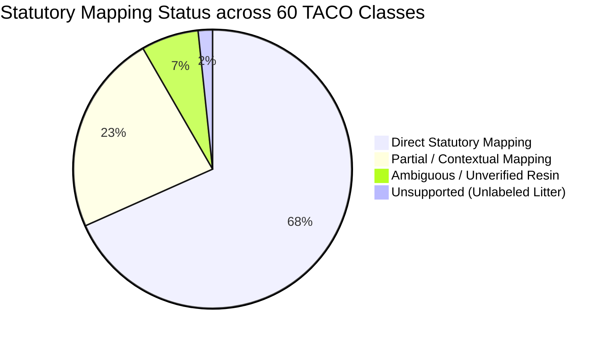
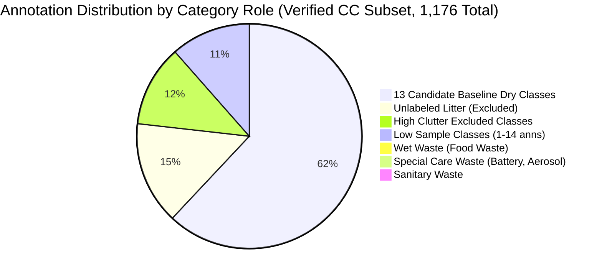
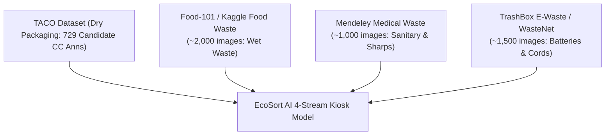

# EcoSort Statutory Taxonomy Coverage & Multi-Stream Deficit Audit

**Project**: EcoSort AI — Multilingual, Multimodal Waste Segregation Kiosk  
**Competition**: Bharat AI-SoC Challenge 2026–27  
**Problem Statement**: PS-02 — Smart Recycling and Waste Segregation  
**Document Version**: 2.1 (Task 5.2.3.2 Reconciled Audit & Material Review)  
**Primary Source Legislation**: Solid Waste Management Rules, 2026 (Notification S.O. 388(E))  
**Knowledge Base Grounding**: [`backend/data/waste_knowledge_base.json`](file:///c:/Users/pavan/Documents/Bharat%20AI-SoC%20Challenge%20%E2%80%94%202026%E2%80%9327/ecosort-ai/backend/data/waste_knowledge_base.json) (42 Verified Items)

---

## 1. Statutory Mapping Breakdown Across 60 TACO Classes

EcoSort AI maps computer vision labels to India's statutory 4-stream waste management rules. Across the 60 defined TACO categories:

- **Directly Supported Classes (41 categories, 68.3%)**: Explicit physical/statutory correspondence to a specific EcoSort class (e.g. `Clear plastic bottle` $\rightarrow$ `dry_plastic_pet_bottles`, `Drink can` $\rightarrow$ `dry_metal_aluminium_cans`, `Glass bottle` $\rightarrow$ `dry_glass_bottles_jars`).
- **Partially Supported Classes (14 categories, 23.3%)**: Requires environmental/usage qualifiers (e.g. `Meal carton` $\rightarrow$ clean belongs to `Dry waste`, food-saturated belongs to `Wet waste`; `Aerosol` $\rightarrow$ empty cosmetic can belongs to `Dry`, insecticide belongs to `Special care`).
- **Ambiguous Classes (4 categories, 6.7%)**: `Tissues`, `Plastic gloves`, `Rope & strings`, `Other plastic`. Material composition cannot be resolved without tactile/chemical confirmation; preserved as unsupported or generalized to prevent hallucination.
- **Unsupported (1 category, 1.7%)**: `Unlabeled litter` (174 annotations in CC subset, 517 in Full). Explicitly rejected under zero-hallucination rules.

---

## 2. Reconciled Four-Stream Statutory Coverage Audit

The statutory **Solid Waste Management Rules, 2026** mandates four segregated collection streams:

| Statutory Waste Stream | Mandatory Kiosk Colour | EcoSort KB Items | TACO Categories | Annotations in Full (1,072 imgs) | Annotations in CC (319 imgs) | Evaluation Viability Using TACO CC Subset Alone |
| :--- | :--- | :---: | :---: | :---: | :---: | :--- |
| **Dry Waste** | **Blue Bin** | 15 items | **53 classes** | **2,999** | **1,002** | **CANDIDATE BASELINE (13 Classes, 729 anns)**: Sufficient instances for initial dry packaging baseline. |
| **Wet Waste** | **Green Bin** | 8 items | **1 class** (`Food waste`) | **8** | **0** | **IMPOSSIBLE**: Zero annotations in Verified CC; only 8 in Full. |
| **Sanitary Waste** | **Red Bin / Wrapped** | 5 items | **0 classes** | **0** | **0** | **IMPOSSIBLE**: Completely absent from TACO schema. |
| **Special Care Waste** | **Deposition Center** | 12 items | **2 classes** (`Battery`, `Aerosol`) | **11** | **0** | **IMPOSSIBLE**: Zero annotations in Verified CC; 11 in Full. |

---

## 3. Review of the 13 Candidate Waste Class Mappings

A rigorous scientific review of all 13 candidate classes establishes the boundary between visual observation, chemical reality, and statutory stream recommendation:

| YOLO ID | TACO Class Name | Visually Observable Feature | Established Material Property | Mapping Certainty | Statutory Disposal Stream (SWM Rules 2026) | Critical Technical & Material Review |
| :---: | :--- | :--- | :--- | :---: | :--- | :--- |
| **0** | Clear plastic bottle | Transparent/tinted bottle body with neck/thread. | Rigid thermoplastic (typically PET, Resin Code 1). | **Direct** | **Dry waste (Blue Bin)** | Beverage bottles are predominantly PET under Category I Rigid Plastics. Transparent PVC or PC is rare in household waste. |
| **1** | Glass bottle | Transparent/coloured cylindrical/contoured glass body. | Inorganic silicate glass. | **Direct** | **Dry waste (Blue Bin)** | 100% recyclable inert container under SWM Rules 2026 Rule 3(zw). Directly supported. |
| **2** | Plastic bottle cap | Circular threaded or snap-on closure. | Rigid thermoplastic closure (PP or HDPE). | **Broad / Functional** | **Dry waste (Blue Bin)** | **Polymer Unverified**: Visual inspection cannot distinguish Polypropylene (PP) from High-Density Polyethylene (HDPE). However, both PP and HDPE are Category I rigid plastics directed to the Dry stream. |
| **3** | Metal bottle cap | Fluted crown cork or metallic twist cap. | Tinplate steel or aluminium alloy. | **Direct** | **Dry waste (Blue Bin)** | Ferrous or non-ferrous recyclable metal closures under Rule 3(zw). Separable via magnetic sorting at MRFs. |
| **4** | Drink can | Two-piece drawn can with stay-on tab. | Non-ferrous aluminium alloy. | **Direct** | **Dry waste (Blue Bin)** | High-grade aluminium alloy with high scrap value under Rule 3(s), 3(zw). Direct alignment. |
| **5** | Other carton | Folding paperboard container (medicine, cereal). | Cellulose paperboard / folding boxboard. | **Direct / Conditional** | **Dry waste (Blue Bin)** | Assumes clean/unsoiled condition. Food-greased cartons must be routed to composting or RDF. |
| **6** | Corrugated carton | Multi-layer shipping box with fluted medium. | Unbleached kraft corrugated cardboard. | **Direct** | **Dry waste (Blue Bin)** | Standard corrugated recyclable packaging under Rule 3(zw). Direct alignment. |
| **7** | Disposable plastic cup | Conical thin-walled plastic drink cup. | Thin-gauge thermoplastic (PP, PET, or HIPS). | **Broad / Functional** | **Dry waste (Blue Bin)** | Polymer resin unverified visually; belongs uniformly to Dry stream for MRF plastic baling. |
| **8** | Other plastic | Miscellaneous plastic fragments, broken pieces, housings. | Unverified polymer debris. | **Broad / Uncertain Polymer** | **Dry waste (Blue Bin)** | **CRITICAL CORRECTION**: Specific polymer (HDPE) CANNOT be inferred from visual appearance alone. Must be classified broadly as unverified rigid plastic destined for Dry waste MRF segregation. |
| **9** | Plastic film | Flexible transparent/translucent sheeting, stretch wrap. | Low-density polyethylene (LDPE/LLDPE). | **Direct** | **Dry waste (Blue Bin)** | Flexible packaging film under Category II Flexible Plastics (PWM Rules). Clean film is recyclable. |
| **10** | Other plastic wrapper | Flexible sealed packaging pouch, snack packet, flow-wrap. | Flexible thermoplastic wrapper (BOPP, PE, or composite). | **Broad / Uncertain Structure** | **Dry waste (Blue Bin)** | **CRITICAL CORRECTION**: Camera cannot verify whether barrier foil or multi-layers are present. Belongs to Dry stream for MRF consolidation; diversion to RDF or recycling occurs at sorting facility. |
| **11** | Styrofoam piece | White or dyed cellular bead foam fragment. | Expanded Polystyrene (EPS, Resin Code 6). | **Direct Material / Distinct from Ban** | **Dry waste (Blue Bin)** | **CRITICAL CORRECTION**: Material is Expanded Polystyrene (EPS / thermocol). A regulatory ban on single-use items is not a material classification. In municipal waste, EPS is dry non-biodegradable waste routed to RDF/co-processing. |
| **12** | Cigarette | Discarded cigarette butt, filter tip, paper wrapper. | Cellulose acetate tow + paper + ash remnant. | **Direct Object / Residual Litter** | **Dry waste (Blue Bin)** | Non-recyclable toxic litter / street sweepings under Rule 3(t), Rule 15; directed to RDF or sanitary engineered landfill. |

---

## 4. Strict Directive: Separation of Visual Detection and Statutory Recommendation

> [!IMPORTANT]
> **Separation of Concerns**:
> 1. **Visual Detection Class**: The computer vision model identifies the physical object category (`plastic_bottle_cap`, `other_plastic`, `other_plastic_wrapper`).
> 2. **Material Verification State**: The model does **not** assert spectroscopic polymer properties (e.g. PP vs HDPE, single-layer vs multi-layer). Where resin is unverified, it is recorded as `unverified_polymer` or `functional_category`.
> 3. **Statutory Waste Stream**: The rule-based knowledge service assigns the statutory bin color (**Blue Bin — Dry Waste**) based on physical recyclability, inert nature, and non-biodegradable status under the Solid Waste Management Rules, 2026.

---

## 5. Multi-Stream Augmentation Roadmap

To achieve genuine 4-stream capability for the Bharat AI-SoC Challenge kiosk:

1. **Wet Waste Augmentation**:
   - Source: Open Food-101 / Kaggle Organic Waste / Garbage Classification Dataset.
   - Target Classes: Cooked food scraps, fruit rinds, vegetable peels, floral offerings.
2. **Sanitary Waste Augmentation**:
   - Source: Mendeley Medical Waste Dataset & custom kiosk chute collection.
   - Target Classes: Pouch-wrapped sanitary napkins, diapers, incontinence underpads.
3. **Special Care Waste Augmentation**:
   - Source: TrashBox & WasteNet datasets.
   - Target Classes: Dry-cell alkaline batteries, lithium button cells, CFL tube lights, blister packs.
