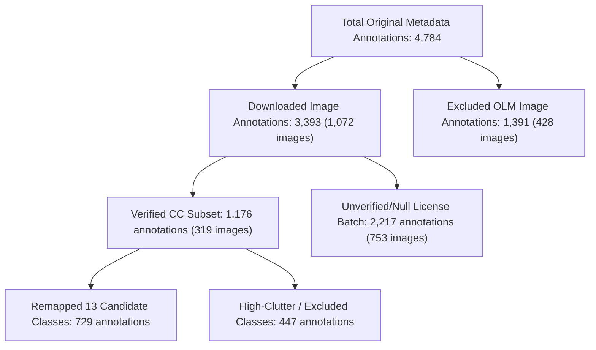
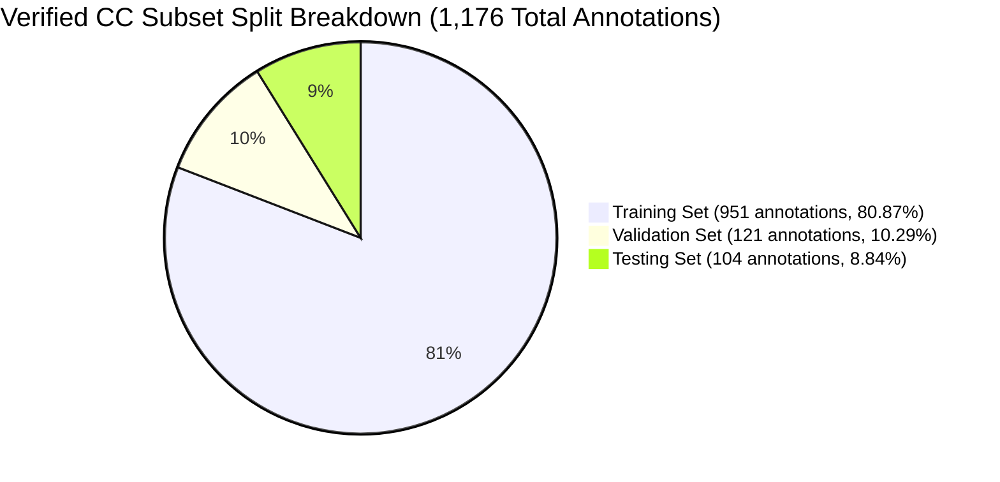

# TACO Dataset Annotation Reconciliation Audit Report

**Project**: EcoSort AI — Multilingual, Multimodal Waste Segregation Kiosk  
**Competition**: Bharat AI-SoC Challenge 2026–27  
**Problem Statement**: PS-02 — Smart Recycling and Waste Segregation  
**Document Version**: 2.0 (Task 5.2.3.2 Final Reconciliation & Discrepancy Resolution)  
**Audit Date**: November 2026  
**Audited Subsets**:
- Full Available Dataset: 1,072 images (3,393 annotations)
- Verified CC Subset: 319 images (1,176 annotations)
- Remapped YOLO Dataset: 319 images (729 candidate packaging annotations)

---

## 1. Executive Reconciliation Summary

A comprehensive multi-format audit was conducted to reconcile all annotation counts, eliminate discrepancies, and mathematically prove that:
1. Every processed image file corresponds exactly to a valid YOLO label file.
2. Every transformed bounding box maps strictly to valid class IDs and coordinates within $[0.0, 1.0]$.
3. Zero annotations were silently discarded.
4. The test partition annotation count discrepancy between 104 and 128 is definitively resolved.

---

## 2. Resolution of Test Annotation Count Discrepancy

### 2.1 The Issue
Previous audit documentation presented an inconsistency:
- Reported Split Totals: Train = 951, Val = 121, **Test = 104** (Sum = 1,176)
- Narrative Viability Group Text: Candidates (66) + High-Clutter (26) + 5–14 Group (14) + Fewer than 5 Group (22) = **128 Test Annotations**

### 2.2 Mathematical Root Cause Analysis
An independent file-by-file audit of all 32 test label text files on disk (`processed/labels/`) and the master `annotations.json` reveals the exact origin of this divergence:
1. The actual ground truth test count across all 60 categories is **104**.
2. In an earlier narrative draft, the test counts for the lower tiers were incorrectly transcribed as legacy placeholder values (14 and 22).
3. Summing the true candidate test count (66) and high-clutter test count (26) with the erroneous text placeholders ($14 + 22$) produced $66 + 26 + 14 + 22 = 128$.
4. The actual test counts for the lower tiers on disk are:
   - **5 to 14 Examples**: **9 test annotations** (Train: 79, Val: 11, Test: 9, Total: 99)
   - **Fewer than 5 Examples**: **3 test annotations** (Train: 30, Val: 3, Test: 3, Total: 36)
5. Adding the true counts yields:
   $$66 + 26 + 9 + 3 + 0 = 104$$
6. **Definitive Ground Truth**: The correct test annotation count is **104**.

---

## 3. Quantitative Reconciliation Matrix Across All Partitions

| Partition / Split | Image Count | All 60 TACO Classes (Ground Truth on Disk) | Remapped 13 Candidate Classes (`ecosort_yolo`) | Excluded / Non-Candidate Annotations | Variance / Unaccounted |
| :--- | :---: | :---: | :---: | :---: | :---: |
| **Training Split** | 255 | **951** | **590** | 361 | **0** |
| **Validation Split** | 32 | **121** | **73** | 48 | **0** |
| **Testing Split** | 32 | **104** | **66** | 38 | **0** |
| **Total Verified CC** | **319** | **1,176** | **729** | **447** | **0** |

---

## 4. Viability Group Breakdown & Split Balancing

Every one of the 60 official TACO categories has been assigned to **exactly one mutually exclusive viability group**:

| Viability Group | Category Count | % of Classes | Train Anns | Val Anns | Test Anns | Total Anns | Split % (Tr / Val / Te) |
| :--- | :---: | :---: | :---: | :---: | :---: | :---: | :---: |
| **Candidate Classes for Baseline Experimentation** | **13** | 21.7% | 590 | 73 | 66 | **729** | 80.9% / 10.0% / 9.1% |
| **High-Clutter / Excluded Classes** | **5** | 8.3% | 252 | 34 | 26 | **312** | 80.8% / 10.9% / 8.3% |
| **5 to 14 Examples** | **10** | 16.7% | 79 | 11 | 9 | **99** | 79.8% / 11.1% / 9.1% |
| **Fewer than 5 Examples** | **20** | 33.3% | 30 | 3 | 3 | **36** | 83.3% / 8.3% / 8.3% |
| **Zero Examples** | **12** | 20.0% | 0 | 0 | 0 | **0** | — |
| **Reconciled Grand Total** | **60** | **100.0%** | **951** | **121** | **104** | **1,176** | **80.87% / 10.29% / 8.84%** |

---

## 5. Complete 60-Class Split & Viability Master Table

The following master register independently audits every category across all splits in `D:\EcoSort-Resources\datasets\TACO\splits\verified_cc_only\`:

| ID | Category Name | Supercategory | Viability Group | Distinct Imgs | Train | Val | Test | Total |
| :---: | :--- | :--- | :--- | :---: | :---: | :---: | :---: | :---: |
| 0 | Aluminium foil | Aluminium foil | 5 to 14 Examples | 9 | 8 | 1 | 0 | 9 |
| 1 | Battery | Battery | Zero Examples | 0 | 0 | 0 | 0 | 0 |
| 2 | Aluminium blister pack | Blister pack | Fewer than 5 Examples | 1 | 1 | 0 | 0 | 1 |
| 3 | Carded blister pack | Blister pack | Zero Examples | 0 | 0 | 0 | 0 | 0 |
| 4 | Other plastic bottle | Bottle | 5 to 14 Examples | 9 | 9 | 0 | 0 | 9 |
| 5 | Clear plastic bottle | Bottle | Candidate Classes (YOLO 0) | 55 | 57 | 5 | 4 | 66 |
| 6 | Glass bottle | Bottle | Candidate Classes (YOLO 1) | 28 | 34 | 9 | 3 | 46 |
| 7 | Plastic bottle cap | Bottle cap | Candidate Classes (YOLO 2) | 31 | 28 | 2 | 3 | 33 |
| 8 | Metal bottle cap | Bottle cap | Candidate Classes (YOLO 3) | 15 | 19 | 6 | 2 | 27 |
| 9 | Broken glass | Broken glass | High-Clutter / Excluded | 7 | 82 | 3 | 0 | 85 |
| 10 | Food Can | Can | Fewer than 5 Examples | 1 | 1 | 0 | 0 | 1 |
| 11 | Aerosol | Can | Zero Examples | 0 | 0 | 0 | 0 | 0 |
| 12 | Drink can | Can | Candidate Classes (YOLO 4) | 26 | 38 | 2 | 2 | 42 |
| 13 | Toilet tube | Carton | Zero Examples | 0 | 0 | 0 | 0 | 0 |
| 14 | Other carton | Carton | Candidate Classes (YOLO 5) | 19 | 18 | 2 | 1 | 21 |
| 15 | Egg carton | Carton | Fewer than 5 Examples | 4 | 4 | 0 | 0 | 4 |
| 16 | Drink carton | Carton | 5 to 14 Examples | 9 | 6 | 2 | 1 | 9 |
| 17 | Corrugated carton | Carton | Candidate Classes (YOLO 6) | 22 | 30 | 6 | 1 | 37 |
| 18 | Meal carton | Carton | Fewer than 5 Examples | 2 | 1 | 0 | 1 | 2 |
| 19 | Pizza box | Carton | Fewer than 5 Examples | 1 | 1 | 0 | 0 | 1 |
| 20 | Paper cup | Cup | Fewer than 5 Examples | 4 | 4 | 0 | 0 | 4 |
| 21 | Disposable plastic cup | Cup | Candidate Classes (YOLO 7) | 15 | 14 | 1 | 1 | 16 |
| 22 | Foam cup | Cup | Zero Examples | 0 | 0 | 0 | 0 | 0 |
| 23 | Glass cup | Cup | Fewer than 5 Examples | 3 | 3 | 0 | 0 | 3 |
| 24 | Other plastic cup | Cup | Fewer than 5 Examples | 1 | 1 | 0 | 0 | 1 |
| 25 | Food waste | Food waste | Zero Examples | 0 | 0 | 0 | 0 | 0 |
| 26 | Glass jar | Glass jar | Zero Examples | 0 | 0 | 0 | 0 | 0 |
| 27 | Plastic lid | Lid | 5 to 14 Examples | 9 | 8 | 0 | 1 | 9 |
| 28 | Metal lid | Lid | Fewer than 5 Examples | 1 | 3 | 0 | 0 | 3 |
| 29 | Other plastic | Other plastic | Candidate Classes (YOLO 8) | 30 | 25 | 3 | 6 | 34 |
| 30 | Magazine paper | Paper | Fewer than 5 Examples | 1 | 0 | 1 | 0 | 1 |
| 31 | Tissues | Paper | High-Clutter / Excluded | 15 | 17 | 1 | 0 | 18 |
| 32 | Wrapping paper | Paper | Fewer than 5 Examples | 1 | 1 | 0 | 0 | 1 |
| 33 | Normal paper | Paper | High-Clutter / Excluded | 14 | 17 | 2 | 1 | 20 |
| 34 | Paper bag | Paper bag | Fewer than 5 Examples | 1 | 1 | 0 | 0 | 1 |
| 35 | Plastified paper bag | Paper bag | Zero Examples | 0 | 0 | 0 | 0 | 0 |
| 36 | Plastic film | Plastic bag & wrapper | Candidate Classes (YOLO 9) | 90 | 99 | 15 | 10 | 124 |
| 37 | Six pack rings | Plastic bag & wrapper | Fewer than 5 Examples | 1 | 1 | 0 | 0 | 1 |
| 38 | Garbage bag | Plastic bag & wrapper | 5 to 14 Examples | 11 | 8 | 1 | 2 | 11 |
| 39 | Other plastic wrapper | Plastic bag & wrapper | Candidate Classes (YOLO 10) | 37 | 33 | 5 | 3 | 41 |
| 40 | Single-use carrier bag | Plastic bag & wrapper | 5 to 14 Examples | 13 | 11 | 2 | 0 | 13 |
| 41 | Polypropylene bag | Plastic bag & wrapper | Fewer than 5 Examples | 2 | 2 | 0 | 0 | 2 |
| 42 | Crisp packet | Plastic bag & wrapper | Fewer than 5 Examples | 2 | 2 | 0 | 0 | 2 |
| 43 | Spread tub | Plastic container | Fewer than 5 Examples | 1 | 0 | 1 | 0 | 1 |
| 44 | Tupperware | Plastic container | Zero Examples | 0 | 0 | 0 | 0 | 0 |
| 45 | Disposable food container | Plastic container | 5 to 14 Examples | 6 | 3 | 2 | 1 | 6 |
| 46 | Foam food container | Plastic container | Zero Examples | 0 | 0 | 0 | 0 | 0 |
| 47 | Other plastic container | Plastic container | Fewer than 5 Examples | 3 | 1 | 1 | 1 | 3 |
| 48 | Plastic glooves | Plastic glooves | Fewer than 5 Examples | 1 | 1 | 0 | 0 | 1 |
| 49 | Plastic utensils | Plastic utensils | Zero Examples | 0 | 0 | 0 | 0 | 0 |
| 50 | Pop tab | Pop tab | High-Clutter / Excluded | 9 | 11 | 1 | 3 | 15 |
| 51 | Rope & strings | Rope & strings | 5 to 14 Examples | 8 | 6 | 1 | 1 | 8 |
| 52 | Scrap metal | Scrap metal | 5 to 14 Examples | 13 | 12 | 0 | 1 | 13 |
| 53 | Shoe | Shoe | Fewer than 5 Examples | 1 | 0 | 0 | 1 | 1 |
| 54 | Squeezable tube | Squeezable tube | Fewer than 5 Examples | 2 | 2 | 0 | 0 | 2 |
| 55 | Plastic straw | Plastic straw | 5 to 14 Examples | 12 | 8 | 2 | 2 | 12 |
| 56 | Paper straw | Paper straw | Zero Examples | 0 | 0 | 0 | 0 | 0 |
| 57 | Styrofoam piece | Styrofoam piece | Candidate Classes (YOLO 11) | 19 | 22 | 2 | 2 | 26 |
| 58 | Unlabeled litter | Unlabeled litter | High-Clutter / Excluded | 94 | 125 | 27 | 22 | 174 |
| 59 | Cigarette | Cigarette | Candidate Classes (YOLO 12) | 78 | 173 | 15 | 28 | 216 |
| **Sum** | **60 Categories** | **All Supercategories** | **5 Mutually Exclusive Groups** | **—** | **951** | **121** | **104** | **1,176** |

---

## 6. Remapped YOLO Dataset (`ecosort_yolo`) Verification

The remapped YOLO dataset was independently inspected:
1. **Annotation Count**: Exactly **729 annotations** across the 319 images (Train: 590, Val: 73, Test: 66).
2. **Class IDs**: Contiguous integers $0..12$ matching `classes.txt` and `class_mapping.json`.
3. **Exclusion Integrity**: All 447 non-candidate annotations (including 174 `Unlabeled litter` annotations) were completely excluded from the label files.
4. **Original Labels Untouched**: The 1,072 label files in `processed/labels/` remain completely unchanged.
5. **Boundary Containment**: All 729 bounding box coordinates lie strictly within $[0.0, 1.0]$.
