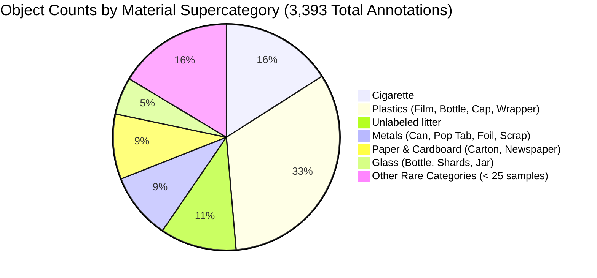

# TACO Dataset Class Distribution & Rare-Class Analysis Report

**Project**: EcoSort AI — Multilingual, Multimodal Waste Segregation Kiosk  
**Competition**: Bharat AI-SoC Challenge 2026–27  
**Problem Statement**: PS-02 — Smart Recycling and Waste Segregation  
**Document Version**: 1.0 (Task 5.2.2 Class Distribution Specification)  
**Distribution Data Path**: [`D:\EcoSort-Resources\datasets\TACO\splits\class_distribution.json`](file:///D:/EcoSort-Resources/datasets/TACO/splits/class_distribution.json)

---

## 1. Executive Summary

This report analyzes the quantitative object distributions across the 1,072 downloaded images (3,393 annotations) and evaluates their statistical viability for YOLO11n object detection.

---

## 2. Quantitative Distribution Tiers

Across the 60 defined TACO categories in the 1,072 downloaded images:

| Distribution Tier | Criteria | Category Count | % of Categories | Evaluation Viability for Edge Benchmark |
| :--- | :--- | :---: | :---: | :--- |
| **Dominant Head** | $\ge 100$ annotations | **8** | 13.3% | **Highly Reliable**: Sufficient samples across train, val, and test splits. |
| **Intermediate Mid-Tail** | $25–99$ annotations | **17** | 28.3% | **Viable for Standard Evaluation**: Adequate train/val representation. |
| **Low-Sample Boundary** | $15–24$ annotations | **9** | 15.0% | **Marginally Evaluable**: High variance across random seeds. |
| **Severe Long-Tail Deficit** | $1–14$ annotations | **24** | 40.0% | **Statistically Non-Evaluable**: Too few samples to measure standalone mAP. |
| **Zero-Sample Categories** | $0$ annotations | **2** | 3.3% | **Unusable**: `Carded blister pack` (0) and `Plastified paper bag` (0). |

---

## 3. Statistically Non-Evaluable Categories (< 15 Annotations)

The following 26 categories contain insufficient examples in the downloaded release to support standalone object detection benchmarking:

| TACO ID | Category Name | Total Annotations | Train | Val | Test | Root Cause & Recommendation |
| :---: | :--- | :---: | :---: | :---: | :---: | :--- |
| **1** | Battery | **1** | 0 | 1 | 0 | Severe deficit in TACO. Augment with **TrashBox** e-waste dataset. |
| **2** | Aluminium blister pack | **4** | 2 | 2 | 0 | Augment with **Mendeley Medical Waste** dataset. |
| **3** | Carded blister pack | **0** | 0 | 0 | 0 | Excluded OLM batch contained the sole example. |
| **11** | Aerosol | **10** | 8 | 1 | 1 | Marginal sample count; high risk of false negatives. |
| **13** | Toilet tube | **5** | 2 | 0 | 3 | Cellulose roll cores; under-represented in litter scenes. |
| **15** | Egg carton | **11** | 11 | 0 | 0 | All 11 examples clustered into training set. |
| **19** | Pizza box | **3** | 3 | 0 | 0 | Insufficient; augment with studio takeaway packaging. |
| **22** | Foam cup | **5** | 5 | 0 | 0 | Thermocol cup deficit. |
| **23** | Glass cup | **6** | 5 | 0 | 1 | Rare in outdoor litter. |
| **24** | Other plastic cup | **2** | 1 | 0 | 1 | Rigid plastic drinkware deficit. |
| **25** | Food waste | **8** | 6 | 1 | 1 | Critical deficit for municipal waste. Augment with **Food-101**. |
| **26** | Glass jar | **6** | 5 | 1 | 0 | Rare in street litter. |
| **28** | Metal lid | **10** | 6 | 4 | 0 | Jar twist-off lids. |
| **30** | Magazine paper | **12** | 3 | 2 | 7 | Coated magazine paper. |
| **32** | Wrapping paper | **3** | 2 | 1 | 0 | Decorative wrapping paper deficit. |
| **35** | Plastified paper bag | **0** | 0 | 0 | 0 | Zero annotations in master TACO release. |
| **37** | Six pack rings | **5** | 4 | 1 | 0 | LDPE carrier rings. |
| **41** | Polypropylene bag | **3** | 3 | 0 | 0 | Woven PP sacks deficit. |
| **43** | Spread tub | **9** | 7 | 1 | 1 | Butter/margarine tubs. |
| **44** | Tupperware | **3** | 2 | 0 | 1 | Reusable food storage containers. |
| **46** | Foam food container | **11** | 9 | 1 | 1 | EPS clamshell meal boxes. |
| **47** | Other plastic container | **4** | 2 | 0 | 2 | Miscellaneous rigid tubs. |
| **48** | Plastic gloves | **4** | 4 | 0 | 0 | Clinical/domestic gloves. |
| **53** | Shoe | **7** | 5 | 1 | 1 | Discarded footwear. |
| **54** | Squeezable tube | **7** | 5 | 2 | 0 | Cosmetic/toothpaste tubes. |
| **56** | Paper straw | **3** | 3 | 0 | 0 | Cellulose straws. |

---

## 4. Evaluation Strategy for EcoSort AI

To ensure scientifically valid performance reporting during model evaluation:
1. **Primary Benchmark**: Compute mAP50 and mAP50-95 exclusively on the **34 statistically evaluable classes** ($\ge 15$ annotations).
2. **Aggregated Stream Benchmark**: Evaluate performance at the **4 Statutory Stream level** (Dry, Wet, Special Care, Sanitary) via the [`dataset_taxonomy_mapping.json`](file:///c:/Users/pavan/Documents/Bharat%20AI-SoC%20Challenge%20%E2%80%94%202026%E2%80%9327/ecosort-ai/backend/app/vision/dataset_taxonomy_mapping.json) mapping layer.
3. **No Artificial Merging**: Categories are preserved as independent statutory entities without merging distinct materials (e.g., aluminium cans are NEVER merged with plastic bottles).
