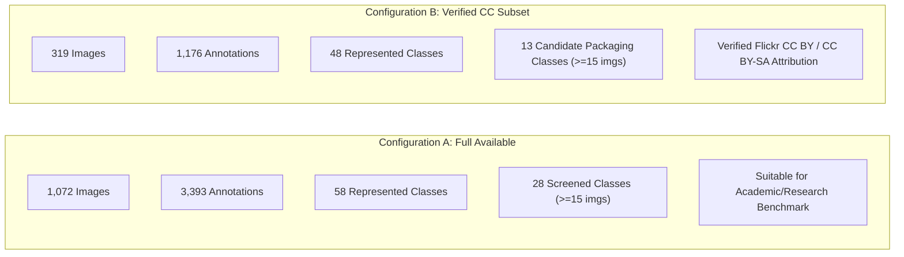
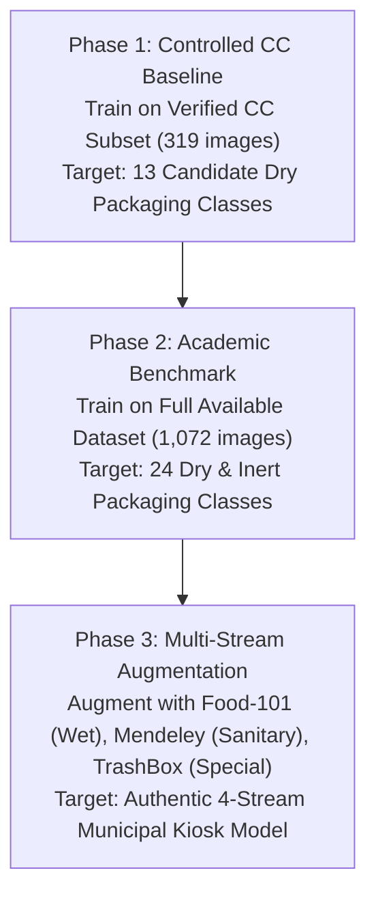

# TACO Dataset Configuration Comparison: Full Available vs. Verified CC Subset

**Project**: EcoSort AI — Multilingual, Multimodal Waste Segregation Kiosk  
**Competition**: Bharat AI-SoC Challenge 2026–27  
**Problem Statement**: PS-02 — Smart Recycling and Waste Segregation  
**Document Version**: 2.0 (Task 5.2.3.1 Consistency & Training Prep Update)

---

## 1. Executive Comparison Matrix

| Metric | Configuration A: Full Available | Configuration B: Verified CC Subset | Delta / Trade-off |
| :--- | :---: | :---: | :--- |
| **Total Images** | **1,072** | **319** | $-70.2\%$ images in Verified CC |
| **Total Annotations** | **3,393** | **1,176** | $-65.3\%$ annotations in Verified CC |
| **Average Objects / Image** | 3.17 | 3.69 | Verified CC contains slightly denser clutter |
| **Represented Classes ($> 0$ count)** | **58 / 60** | **48 / 60** | 10 classes lose all representation in Verified CC |
| **Classes with $\ge 15$ Annotations** | **34** | **18** | $-47.1\%$ classes with adequate sample depth |
| **Classes with $\ge 15$ Distinct Images** | **28** | **14** (13 waste + 1 litter) | $-50.0\%$ candidate baseline classes |
| **Candidate Classes for Baseline** | **24** | **13** | Selected packaging classes with test instances |
| **Severe Long-Tail Deficit Classes ($< 15$)** | 26 | 42 | Long-tail sparsity increases dramatically in CC |
| **Class Imbalance Ratio** (Top : Median) | **30 : 1** (541 : 18) | **108 : 1** (216 : 2) | Class imbalance is $3.6\times$ worse in Verified CC |
| **Wet Waste Examples** (`Food waste`) | 8 annotations | **0 annotations** | Wet waste completely vanishes in Verified CC |
| **Special Care Examples** (`Battery`, `Aerosol`) | 11 annotations | **0 annotations** | Special Care completely vanishes in Verified CC |
| **Licensing Composition** | 319 CC, 38 ODbL, 715 Unspecified | **319 CC (Flickr CC BY & CC BY-SA)** | Verified CC excludes ODbL and null-record images |
| **Compliance Profile** | Conditional / Research Only | **Documented CC Attribution** | Verified creators; CC BY-SA share-alike terms apply |

---

## 2. Practical Trade-off: Scale vs. Licensing Governance

### 2.1 Configuration A (Full Available — 1,072 Images)
- **Advantages**:
  - Nearly $3\times$ more training images and annotations (3,393 annotations).
  - Represents 58 classes with 28 candidate classes meeting the $\ge 15$ distinct image threshold.
  - Superior visual diversity across varied lighting, environments, and clutter levels.
  - Retains minimal representation for food waste (8) and battery/aerosols (11).
- **Disadvantages & Considerations**:
  - Contains 715 images where individual photographer licenses were unspecified/null in the TACO annotations JSON (though TACO compilation is CC BY 4.0).
  - Contains 38 OpenLitterMap images subject to Open Database License (ODbL) terms. ODbL is a database license requiring publicly shared derived databases to be shared under ODbL; it does not ban commercial use but imposes specific open data obligations.
- **Appropriate Role**: **Academic Benchmarking, Research Ablation Studies, Architecture Exploration for the Challenge submission.**

---

### 2.2 Configuration B (Verified CC Subset — 319 Images)
- **Advantages**:
  - All 319 photographs have documented Flickr Creative Commons licenses (`CC BY 2.0` or `CC BY-SA 2.0`).
  - Completely excludes the 38 ODbL database images and 715 unverified null-record images.
  - Full creator provenance and URLs cataloged in [`manifests/image_licensing_manifest.csv`](file:///D:/EcoSort-Resources/datasets/TACO/manifests/image_licensing_manifest.csv).
- **Disadvantages & Considerations**:
  - Severe class starvation: 12 classes have 0 samples; 20 classes have $< 5$ samples (including `Metal lid` with 3 annotations across 1 image).
  - Complete absence of Wet waste (`Food waste` = 0) and Special Care waste (`Battery` = 0, `Aerosol` = 0).
  - High class imbalance (108:1 between Cigarette and median classes).
  - Small training set (255 images) increases the risk of overfitting.
  - Downstream models trained on CC BY-SA images may carry share-alike licensing obligations under certain interpretations of derivative works.
- **Appropriate Role**: **Controlled Baseline Experimentation on 13 Dry Packaging Classes.**

---

## 3. Recommended Phased Strategy

To balance rigorous IP governance with competitive model accuracy:

1. **Phase 1 (Controlled CC Baseline)**: Train YOLO11n on the 319-image Verified CC subset using the **13 candidate Dry packaging classes** to establish an uncontested baseline with documented provenance.
2. **Phase 2 (Academic Benchmark)**: Train a companion YOLO11n model on the 1,072-image Full split to measure the mAP gain unlocked by broader visual diversity under fair academic evaluation.
3. **Phase 3 (Multi-Stream Augmentation)**: Address the fundamental Wet/Sanitary/Special Care deficit by integrating domain-specific open datasets before deploying to the Raspberry Pi 5 + Hailo-8 kiosk.
