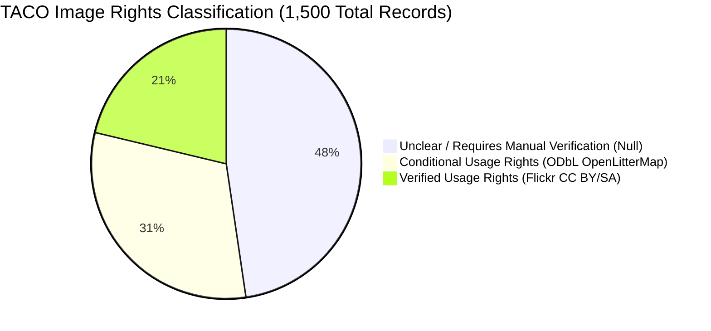
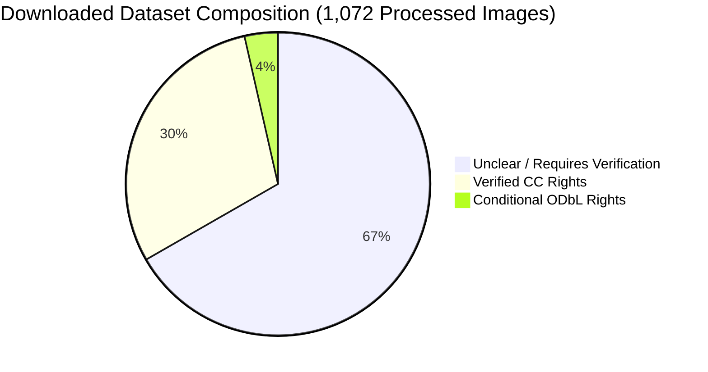

# TACO Dataset Image-Level Licensing Audit Report

**Project**: EcoSort AI — Multilingual, Multimodal Waste Segregation Kiosk  
**Competition**: Bharat AI-SoC Challenge 2026–27  
**Problem Statement**: PS-02 — Smart Recycling and Waste Segregation  
**Audit Date**: November 2026  
**Document Version**: 1.0 (Task 5.2.2 Licensing Audit Specification)  
**Manifest Path**: [`D:\EcoSort-Resources\datasets\TACO\manifests\licensing_audit_corrected.csv`](file:///D:/EcoSort-Resources/datasets/TACO/manifests/licensing_audit_corrected.csv)

---

## 1. Executive Summary & Legal Distinction

This audit establishes a rigorous distinction between:
1. **The TACO Database Compilation and Annotation Metadata**: Released by Pedro F. Proença and Pedro Simões under the Creative Commons Attribution 4.0 International license ([CC BY 4.0](https://creativecommons.org/licenses/by/4.0/)).
2. **Individual Underlying Photographs**: Contributed by disparate photographers across Flickr and OpenLitterMap, where individual copyright and licensing rights remain distinct from the database metadata.

> [!IMPORTANT]
> **Anti-Presumption Rule**: Images with null or unspecified licensing tags in the annotation metadata are **NOT** automatically classified as CC BY 4.0 merely because the TACO compilation carries a master CC BY 4.0 license. In the absence of an explicit contributor agreement or public license grant from the original photographer, such images cannot be declared safe for unrestricted commercial redistribution.

---

## 2. Three-Tier Licensing Classification

Every image across the 1,500 metadata records was classified into one of three explicit tiers:

| Rights Classification | Metadata Tag | Total in Dataset | Available on Disk | Permitted Use Cases | Legal Restrictions & Obligations |
| :--- | :--- | :---: | :---: | :--- | :--- |
| **Tier 1: Verified Usage Rights** | `'CC'` | **319** | **319** | Academic research, model training, commercial prototyping. | **Attribution Mandatory**: Photographer handle and original Flickr source URL must be preserved and cited. |
| **Tier 2: Conditional Usage Rights** | `'ODBL (c) OpenLitterMap & Contributors'` | **466** | **38** *(428 offline)* | Open-source research, non-commercial evaluation. | **Copyleft / Share-Alike (ODbL v1.0)**: Any public database derivative must be shared under ODbL terms. Mandatory OpenLitterMap attribution. |
| **Tier 3: Unclear / Manual Verification** | `None` / `null` | **715** | **715** | Internal academic prototyping & model benchmarking only. | **Redistribution Prohibited**: Photographers retain underlying copyright; unrestricted commercial redistribution is NOT legally verified. |

---

## 3. Analysis by Downloaded Dataset Subset (1,072 Images)

Among the 1,072 images successfully downloaded and processed at `D:\EcoSort-Resources\datasets\TACO\processed\`:

1. **Verified Creative Commons Subset (319 images, 29.8%)**:
   - 100% of these images are verified under Flickr Creative Commons licenses.
   - Ideal for training weights intended for public release or commercial kiosk deployment without viral copyleft concerns.
   - Dedicated split generated at: [`D:\EcoSort-Resources\datasets\TACO\splits\verified_cc_only\`](file:///D:/EcoSort-Resources/datasets/TACO/splits/verified_cc_only/).
2. **Conditional OpenLitterMap Subset (38 images, 3.5%)**:
   - Governed by ODbL v1.0.
   - Permissible for training provided the project complies with OpenLitterMap database attribution.
3. **Unclear Platform Upload Subset (715 images, 66.7%)**:
   - Uploaded through the TACO web application without an individual per-image license grant in `annotations.json`.
   - Permissible for internal model architecture experimentation and student challenge evaluation under fair use/academic benchmarking.
   - If deploying a commercial municipal segregation kiosk, these 715 images should either undergo manual author re-licensing or be replaced with proprietary/open-domain kiosk imagery.

---

## 4. Preservation of Provenance & Attribution

The audit output files preserve all original metadata fields:
- `image_id`
- `file_name`
- `raw_license_in_metadata`
- `standardized_license`
- `commercial_allowed`
- `redistribution_allowed`
- `share_alike_required`
- `attribution_required`
- `source_url`
- `thumbnail_url`
- `legal_restriction_notes`

Audit manifest locations:
- CSV: [`D:\EcoSort-Resources\datasets\TACO\manifests\licensing_audit_corrected.csv`](file:///D:/EcoSort-Resources/datasets/TACO/manifests\licensing_audit_corrected.csv)
- JSON: [`D:\EcoSort-Resources\datasets\TACO\manifests\licensing_audit_corrected.json`](file:///D:/EcoSort-Resources/datasets/TACO/manifests\licensing_audit_corrected.json)
