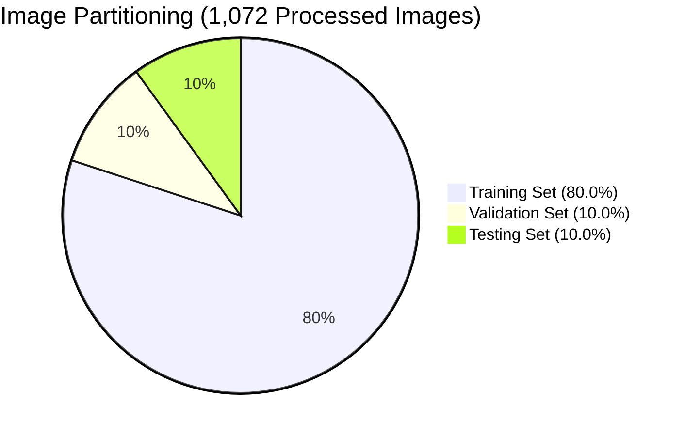

# TACO Dataset Train/Validation/Test Split Specification Report

**Project**: EcoSort AI — Multilingual, Multimodal Waste Segregation Kiosk  
**Competition**: Bharat AI-SoC Challenge 2026–27  
**Problem Statement**: PS-02 — Smart Recycling and Waste Segregation  
**Target Hardware**: Raspberry Pi 5 + AI HAT+ 2 (Hailo-8 / Hailo-8L NPU)  
**Document Version**: 1.0 (Task 5.2.2 Dataset Split Specification)  
**Random Seed**: `42`  
**Dataset Location**: [`D:\EcoSort-Resources\datasets\TACO\splits\`](file:///D:/EcoSort-Resources/datasets/TACO/splits/)

---

## 1. Executive Split Summary

To ensure scientifically valid and reproducible model training, the 1,072 downloaded images (3,393 annotations) were partitioned into approximate **80% Training**, **10% Validation**, and **10% Testing** splits.

### 1.1 Key Guarantees
1. **Zero Data Leakage**:
   - $S_{\text{train}} \cap S_{\text{val}} = \emptyset$
   - $S_{\text{train}} \cap S_{\text{test}} = \emptyset$
   - $S_{\text{val}} \cap S_{\text{test}} = \emptyset$
   - $S_{\text{train}} \cup S_{\text{val}} \cup S_{\text{test}} = \text{Full Downloaded Dataset (1,072 images)}$
2. **Duplicate & Near-Duplicate Cluster Protection**:
   - 8 duplicate and near-duplicate burst clusters (19 images) were grouped using cryptographic MD5 and perceptual dHash (Hamming distance $\le 4$).
   - **Cluster Integrity Verified**: All members of any duplicate cluster are strictly assigned to the exact same partition. No cluster was split across train, val, or test.
3. **Multilabel Stratification**:
   - Iterative stratification heuristic applied to balance the distribution of rare packaging classes across the splits.
4. **Licensing Transparency**:
   - Every image record in `split_manifest.json` carries its verified licensing rights tier (`Verified usage rights`, `Conditional usage rights`, `Unclear / requires manual verification`).
   - A dedicated **Verified CC-Only Sub-Split** (319 images) is provided in `splits/verified_cc_only/` for strict copyright compliance.

---

## 2. Partition Summary Statistics

### 2.1 Full Available Dataset Split (1,072 Images)

| Partition | Image Count | % of Images | Annotation Count | % of Annotations | Avg Objects / Image | Path File |
| :--- | :---: | :---: | :---: | :---: | :---: | :--- |
| **Train** | **858** | **80.0%** | **2,724** | **80.3%** | 3.17 | [`splits/train.txt`](file:///D:/EcoSort-Resources/datasets/TACO/splits/train.txt) |
| **Validation** | **107** | **10.0%** | **311** | **9.2%** | 2.91 | [`splits/val.txt`](file:///D:/EcoSort-Resources/datasets/TACO/splits/val.txt) |
| **Test** | **107** | **10.0%** | **358** | **10.6%** | 3.35 | [`splits/test.txt`](file:///D:/EcoSort-Resources/datasets/TACO/splits/test.txt) |
| **Total** | **1,072** | **100.0%** | **3,393** | **100.0%** | **3.17** | [`splits/split_manifest.json`](file:///D:/EcoSort-Resources/datasets/TACO/splits/split_manifest.json) |

### 2.2 Verified CC-Only Sub-Split (319 Images)

| Partition | Image Count | % of Images | Path File |
| :--- | :---: | :---: | :--- |
| **Train** | **255** | **79.9%** | [`splits/verified_cc_only/train.txt`](file:///D:/EcoSort-Resources/datasets/TACO/splits/verified_cc_only/train.txt) |
| **Validation** | **32** | **10.0%** | [`splits/verified_cc_only/val.txt`](file:///D:/EcoSort-Resources/datasets/TACO/splits/verified_cc_only/val.txt) |
| **Test** | **32** | **10.0%** | [`splits/verified_cc_only/test.txt`](file:///D:/EcoSort-Resources/datasets/TACO/splits/verified_cc_only/test.txt) |
| **Total** | **319** | **100.0%** | Unambiguous Creative Commons Attribution rights. |

---

## 3. Duplicate Clusters Protection Audit

The following 8 clusters were preserved intact within their assigned splits:

| Cluster Root | Member Image IDs | Detection Method | Split Assigned | Protection Result |
| :---: | :--- | :--- | :---: | :--- |
| **#134** | `[123, 134]` | Perceptual dHash (dist=4) | **Train** | Both images kept in Train. Zero test leakage. |
| **#1483** | `[124, 161, 181, 1483]` | Perceptual dHash (dist=3–4, beach burst) | **Train** | All 4 burst photos kept in Train. |
| **#989** | `[234, 988, 989]` | Perceptual dHash (dist=2–3, multi-angle) | **Train** | All 3 multi-angle photos kept in Train. |
| **#1110** | `[1081, 1110]` | Perceptual dHash (dist=1) | **Train** | Both photos kept in Train. |
| **#1147** | `[1084, 1147]` | Perceptual dHash (dist=4) | **Train** | Both photos kept in Train. |
| **#1164** | `[1096, 1164]` | Perceptual dHash (dist=1) | **Train** | Both photos kept in Train. |
| **#1157** | `[1131, 1157]` | Perceptual dHash (dist=2) | **Train** | Both photos kept in Train. |
| **#1305** | `[1173, 1305]` | **Exact Cryptographic MD5** | **Train** | Identical images kept in Train. Zero evaluation bias. |

---

## 4. Generated Artifacts & File Register

1. **`splits/train.txt`**: 858 absolute POSIX paths to training images.
2. **`splits/val.txt`**: 107 absolute POSIX paths to validation images.
3. **`splits/test.txt`**: 107 absolute POSIX paths to testing images.
4. **`splits/split_manifest.json`**: Complete audit record linking each of the 1,072 images to its split, cluster ID, licensing tier, and annotation count.
5. **`splits/class_distribution.json`**: Granular breakdown of object counts per category across Train, Val, and Test partitions.
6. **`splits/verified_cc_only/`**: Independent sub-split files for the 319 Creative Commons verified images.
