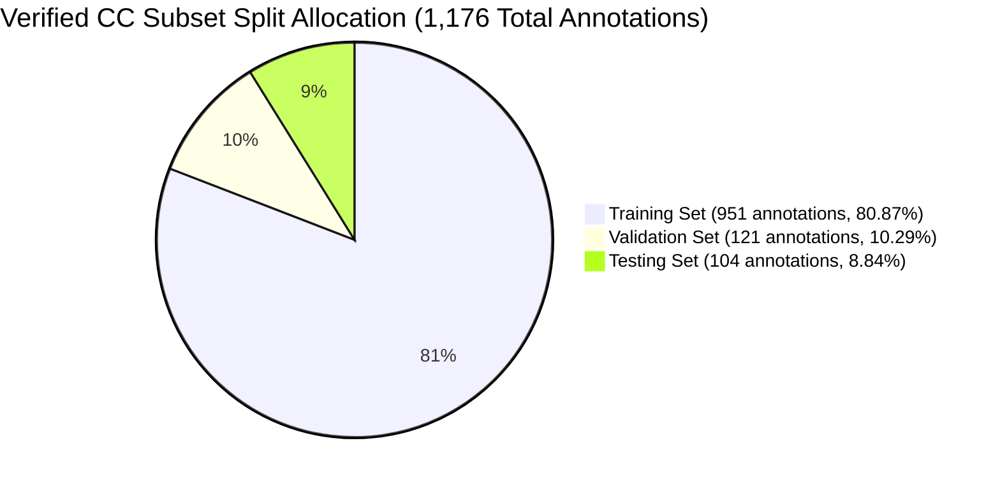

# TACO Verified CC Subset Audit & Training Readiness Specification

**Project**: EcoSort AI — Multilingual, Multimodal Waste Segregation Kiosk  
**Competition**: Bharat AI-SoC Challenge 2026–27  
**Problem Statement**: PS-02 — Smart Recycling and Waste Segregation  
**Target Hardware**: Raspberry Pi 5 + AI HAT+ 2 (Hailo-8 / Hailo-8L NPU)  
**Document Version**: 2.1 (Task 5.2.3.2 Reconciled Audit & Taxonomy Review)  
**Audited Partition**: [`D:\EcoSort-Resources\datasets\TACO\splits\verified_cc_only\`](file:///D:/EcoSort-Resources/datasets/TACO/splits/verified_cc_only/) (319 Images)  
**Audit Data Path**: [`D:\EcoSort-Resources\datasets\TACO\manifests\final_training_readiness_audit.json`](file:///D:/EcoSort-Resources/datasets/TACO/manifests/final_training_readiness_audit.json)

---

## 1. Executive Audit Summary

The **Verified Creative Commons (CC) Subset** consists of **319 images** containing **1,176 bounding box annotations** whose image-level provenance is documented under Flickr Creative Commons licenses (`CC BY` and `CC BY-SA`).

### 1.1 Training Readiness Verdict: `PROCEED WITH RESTRICTIONS`
- **Permissible Scope**: Approved for training an initial experimental baseline on **13 Candidate Classes for Baseline Experimentation** representing common Dry Packaging materials.
- **Critical Restrictions**:
  1. **Zero Statutory Stream Coverage for Wet, Sanitary, and Special Care**: In this 319-image subset, `Food waste` (Wet), `Battery` (Special Care), and `Aerosol` (Special Care) have **0 annotations**. TACO has zero sanitary classes. **No multi-stream segregation claims can be made from this subset alone.**
  2. **Selective Evaluation Mandatory**: 47 out of 60 TACO classes are excluded from baseline training due to extreme sparsity (< 15 annotations), clustering/clutter artifacts, or lack of class-specific semantics (`Unlabeled litter`). Baseline training and evaluation are restricted strictly to the 13 candidate classes.
  3. **Screening Limitations**: While 13 classes met initial screening criteria ($\ge 15$ annotations across the subset), several classes have very limited validation and test instances (e.g. 1 or 2 test bounding boxes). Performance metrics on these classes must be interpreted as preliminary baseline indicators rather than definitive benchmarks.
  4. **Taxonomy & Material Reality**: Visual bounding-box detection alone does not establish polymer resin codes (e.g. PP vs HDPE) or layer structures (mono vs multi-layer packaging). Mappings from visual detections to waste knowledge-base items must preserve this distinction.

---

## 2. Reconciled Verified Subset Class Distribution

Programmatic calculation of all 60 TACO categories across the 319 verified images partitions the classes into five mutually exclusive groups summing to exactly 60 categories and exactly 1,176 annotations:

| Distribution Tier | Criteria | Category Count | % of Categories | Train Anns | Val Anns | Test Anns | Total Anns | Evaluation & Training Role |
| :--- | :--- | :---: | :---: | :---: | :---: | :---: | :---: | :--- |
| **Candidate Classes for Baseline Experimentation** | $\ge 15$ annotations, $\ge 15$ distinct images, $\ge 1$ test annotation, specific packaging material | **13** | **21.7%** | 590 | 73 | 66 | **729** | **Baseline Candidates**: Remapped to contiguous IDs $0..12$ for initial YOLO11n dry packaging baseline. |
| **High-Clutter / Excluded Classes** | $\ge 15$ annotations BUT $< 15$ distinct images, 0 test instances, or non-specific litter | **5** | **8.3%** | 252 | 34 | 26 | **312** | **Excluded**: High spatial correlation/clustering or non-specific semantic category (`Unlabeled litter`). |
| **5 to 14 Examples** | $5–14$ annotations across the 319 images | **10** | **16.7%** | 79 | 11 | 9 | **99** | **Excluded**: Insufficient statistical representation across train/val/test splits. |
| **Fewer than 5 Examples** | $1–4$ annotations across the 319 images | **20** | **33.3%** | 30 | 3 | 3 | **36** | **Excluded**: Severe long-tail deficit (includes `Metal lid` with 3 annotations across 1 image). |
| **Zero Examples** | **0 annotations** in the verified subset | **12** | **20.0%** | 0 | 0 | 0 | **0** | **Absent**: No visual samples present in the 319 verified images. |
| **Reconciled Grand Total** | **Mutually exclusive sum across all tiers** | **60** | **100.0%** | **951** | **121** | **104** | **1,176** | **Complete TACO Taxonomy on Disk** |

---

## 3. Detailed Class Breakdown Table (Verified CC Subset)

### 3.1 Candidate Classes for Baseline Experimentation (13 Dry Packaging Classes)

These 13 classes are mapped into contiguous YOLO class IDs $[0..12]$ in [`D:\EcoSort-Resources\datasets\TACO\ecosort_yolo\data.yaml`](file:///D:/EcoSort-Resources/datasets/TACO/ecosort_yolo/data.yaml). They account for **729 annotations** across the 319 images (Train: 590, Val: 73, Test: 66).

| YOLO ID | TACO ID | Class Name | Supercategory | Total Anns | Distinct Imgs | Train | Val | Test | Evaluation Screening Caveat | Statutory Stream |
| :---: | :---: | :--- | :--- | :---: | :---: | :---: | :---: | :---: | :--- | :--- |
| **0** | **5** | Clear plastic bottle | Bottle | 66 | 55 | 57 | 5 | 4 | Balanced distribution | **Dry waste** (PET) |
| **1** | **6** | Glass bottle | Bottle | 46 | 28 | 34 | 9 | 3 | Adequate sample depth | **Dry waste** (Glass) |
| **2** | **7** | Plastic bottle cap | Bottle cap | 33 | 31 | 28 | 2 | 3 | Adequate sample depth | **Dry waste** (Rigid closure) |
| **3** | **8** | Metal bottle cap | Bottle cap | 27 | 15 | 19 | 6 | 2 | Small test sample ($N=2$) | **Dry waste** (Steel/Tin) |
| **4** | **12** | Drink can | Can | 42 | 26 | 38 | 2 | 2 | Small val/test samples ($N=2, 2$) | **Dry waste** (Aluminium) |
| **5** | **14** | Other carton | Carton | 21 | 19 | 18 | 2 | 1 | Small test sample ($N=1$) | **Dry waste** (Paperboard) |
| **6** | **17** | Corrugated carton | Carton | 37 | 22 | 30 | 6 | 1 | Small test sample ($N=1$) | **Dry waste** (Cardboard) |
| **7** | **21** | Disposable plastic cup | Cup | 16 | 15 | 14 | 1 | 1 | Sparse val/test ($N=1, 1$) | **Dry waste** (Thermoplastic cup) |
| **8** | **29** | Other plastic | Other plastic | 34 | 30 | 25 | 3 | 6 | Broad visual variance | **Dry waste** (Rigid plastic) |
| **9** | **36** | Plastic film | Plastic bag & wrapper | 124 | 90 | 99 | 15 | 10 | Well represented across splits | **Dry waste** (LDPE film) |
| **10** | **39** | Other plastic wrapper | Plastic bag & wrapper | 41 | 37 | 33 | 5 | 3 | Adequate sample depth | **Dry waste** (Flexible wrapper) |
| **11** | **57** | Styrofoam piece | Styrofoam piece | 26 | 19 | 22 | 2 | 2 | Small test sample ($N=2$) | **Dry waste** (Cellular EPS) |
| **12** | **59** | Cigarette | Cigarette | 216 | 78 | 173 | 15 | 28 | Dominant class ($29.6\%$ of candidates) | **Dry waste** (Inerts / RDF) |

> [!NOTE]
> **Evaluation Screening Limitations**:
> While these 13 classes have at least 15 total instances and 15 distinct images, classes such as `Disposable plastic cup` (1 val, 1 test), `Other carton` (2 val, 1 test), and `Corrugated carton` (6 val, 1 test) have single-instance test partitions. A single missed detection on test data will result in an AP of 0.0 for that class. Evaluation on these classes must be reported with explicit sample-size disclaimers.

---

### 3.2 High-Clutter and Excluded Classes (5 Classes)

These 5 classes have $\ge 15$ annotations but fail screening due to clustering artifacts, zero test instances, or non-specific definitions. They total **312 annotations** (Train: 252, Val: 34, Test: 26).

1. **`Unlabeled litter` (ID 58)**: 174 annotations across 94 images (Train: 125, Val: 27, Test: 22). Excluded to prevent the model from learning an ambiguous "garbage" catch-all that obscures specific recyclable streams.
2. **`Broken glass` (ID 9)**: 85 annotations across only 7 images (Train: 82, Val: 3, Test: 0). 42 shards occur in a single photograph. Zero test instances preclude test evaluation.
3. **`Normal paper` (ID 33)**: 20 annotations across 14 distinct images (Train: 17, Val: 2, Test: 1). Fails the distinct-image threshold ($< 15$).
4. **`Tissues` (ID 31)**: 18 annotations across 15 images (Train: 17, Val: 1, Test: 0). Zero test instances preclude test evaluation.
5. **`Pop tab` (ID 50)**: 15 annotations across only 9 distinct images (Train: 11, Val: 1, Test: 3). Highly clustered; fails distinct-image threshold ($< 15$).

---

### 3.3 Low Sample Boundary Classes (10 Classes, 5–14 Examples)

Total **99 annotations** (Train: 79, Val: 11, Test: 9):
- `Aluminium foil` (ID 0): 9 anns (Train: 8, Val: 1, Test: 0)
- `Other plastic bottle` (ID 4): 9 anns (Train: 9, Val: 0, Test: 0)
- `Drink carton` (ID 16): 9 anns (Train: 6, Val: 2, Test: 1)
- `Plastic lid` (ID 27): 9 anns (Train: 8, Val: 0, Test: 1)
- `Garbage bag` (ID 38): 11 anns (Train: 8, Val: 1, Test: 2)
- `Single-use carrier bag` (ID 40): 13 anns (Train: 11, Val: 2, Test: 0)
- `Disposable food container` (ID 45): 6 anns (Train: 3, Val: 2, Test: 1)
- `Rope & strings` (ID 51): 8 anns (Train: 6, Val: 1, Test: 1)
- `Scrap metal` (ID 52): 13 anns (Train: 12, Val: 0, Test: 1)
- `Plastic straw` (ID 55): 12 anns (Train: 8, Val: 2, Test: 2)

---

### 3.4 Severe Long-Tail Deficit Classes (20 Classes, 1–4 Examples)

Total **36 annotations** (Train: 30, Val: 3, Test: 3):
- `Aluminium blister pack` (ID 2): 1 ann (Train: 1, Val: 0, Test: 0)
- `Food Can` (ID 10): 1 ann (Train: 1, Val: 0, Test: 0)
- `Egg carton` (ID 15): 4 anns (Train: 4, Val: 0, Test: 0)
- `Meal carton` (ID 18): 2 anns (Train: 1, Val: 0, Test: 1)
- `Pizza box` (ID 19): 1 ann (Train: 1, Val: 0, Test: 0)
- `Paper cup` (ID 20): 4 anns (Train: 4, Val: 0, Test: 0)
- `Glass cup` (ID 23): 3 anns (Train: 3, Val: 0, Test: 0)
- `Other plastic cup` (ID 24): 1 ann (Train: 1, Val: 0, Test: 0)
- **`Metal lid` (ID 28)**: **3 annotations across 1 image** (Train: 3, Val: 0, Test: 0)
- `Magazine paper` (ID 30): 1 ann (Train: 0, Val: 1, Test: 0)
- `Wrapping paper` (ID 32): 1 ann (Train: 1, Val: 0, Test: 0)
- `Paper bag` (ID 34): 1 ann (Train: 1, Val: 0, Test: 0)
- `Six pack rings` (ID 37): 1 ann (Train: 1, Val: 0, Test: 0)
- `Polypropylene bag` (ID 41): 2 anns (Train: 2, Val: 0, Test: 0)
- `Crisp packet` (ID 42): 2 anns (Train: 2, Val: 0, Test: 0)
- `Spread tub` (ID 43): 1 ann (Train: 0, Val: 1, Test: 0)
- `Other plastic container` (ID 47): 3 anns (Train: 1, Val: 1, Test: 1)
- `Plastic glooves` (ID 48): 1 ann (Train: 1, Val: 0, Test: 0)
- `Shoe` (ID 53): 1 ann (Train: 0, Val: 0, Test: 1)
- `Squeezable tube` (ID 54): 2 anns (Train: 2, Val: 0, Test: 0)

---

### 3.5 Absent Classes in Verified CC Subset (12 Zero-Sample Classes)

The following 12 classes have **0 annotations** in the Verified CC subset:
1. `Battery` (ID 1) — Special Care waste
2. `Carded blister pack` (ID 3)
3. `Aerosol` (ID 11) — Special Care waste
4. `Toilet tube` (ID 13)
5. `Foam cup` (ID 22)
6. `Food waste` (ID 25) — **Wet waste (CRITICAL ZERO)**
7. `Glass jar` (ID 26)
8. `Plastified paper bag` (ID 35)
9. `Tupperware` (ID 44)
10. `Foam food container` (ID 46)
11. `Plastic utensils` (ID 49)
12. `Paper straw` (ID 56)

---

## 4. Split Integrity & Leakage Prevention

The 319-image partition was independently verified:
- **Disjointness**: $S_{\text{train}} \cap S_{\text{val}} = \emptyset, \quad S_{\text{train}} \cap S_{\text{test}} = \emptyset, \quad S_{\text{val}} \cap S_{\text{test}} = \emptyset$
- **File Existence**: All 319 JPEG images and all 319 original label files exist on disk.
- **Coordinate Bounds**: All 1,176 bounding boxes have coordinates strictly within $[0.0, 1.0]$.
- **Leakage Prevention**: All duplicate, burst, and consecutive photo sequences identified during ingestion were assigned to the same split (predominantly training) to prevent visual leakage.

---

## 5. Licensing Governance & Compliance Terms

1. **Image Provenance**:
   - The 319 images were sourced from Flickr with photographer tags declaring Creative Commons licenses (`CC BY 2.0`, `CC BY-SA 2.0`, or compatible CC variants).
   - CC BY permits commercial and non-commercial use, adaptation, and distribution, provided appropriate attribution is given.
   - CC BY-SA permits similar uses but mandates that derivative works (such as modified image datasets or combined visual works) must be shared under identical or compatible share-alike terms.
2. **Attribution Maintenance**:
   - Provenance records including Flickr image IDs, original image URLs, photographer names/usernames, and declared license tags are preserved in [`manifests/image_licensing_manifest.csv`](file:///D:/EcoSort-Resources/datasets/TACO/manifests/image_licensing_manifest.csv).
3. **Database vs. Image Licensing**:
   - The master TACO annotation dataset is distributed under CC BY 4.0.
   - OpenLitterMap contributions (38 images) governed by the Open Database License (ODbL) are excluded from this 319-image subset. ODbL requires derived databases to be licensed under ODbL upon public distribution.
   - 715 images in the broader TACO download lacked explicit individual license strings in the original metadata; those images are excluded from this verified subset to prevent copyright uncertainty.
4. **Scope of Claim**:
   - Training on this subset ensures transparency and verifiable attribution, but any public redistribution of the dataset or directly derived visual assets must honor the respective CC BY and CC BY-SA attribution and share-alike obligations.
