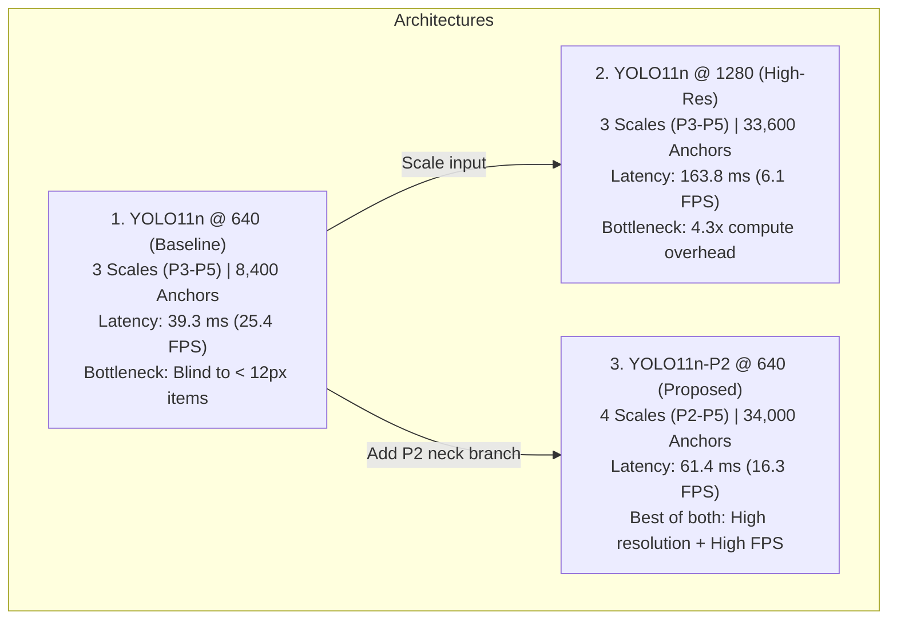
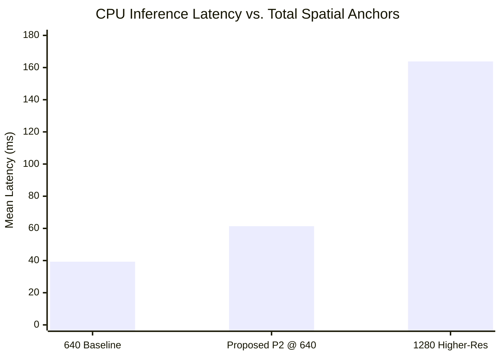

# EcoSort AI — YOLO11n Architecture Comparison: Baseline vs. 1280 vs. P2

**Project**: EcoSort AI (Edge-Optimized Waste Segregation System)  
**Challenge**: Bharat AI-SoC Challenge 2026–27 (Problem Statement 2: Smart Recycling & Waste Segregation)  
**Architectures Evaluated**:
1. **YOLO11n @ 640** (Standard 3-scale baseline: $P3, P4, P5$)
2. **YOLO11n @ 1280** (Higher-resolution 3-scale experiment: $P3, P4, P5$)
3. **YOLO11n-P2 @ 640** (Proposed 4-scale architecture: $P2, P3, P4, P5$)

---

## 1. Executive Summary

Following the completion of the 640 baseline (Task 5.3) and the 1280 experiment (Task 5.4.1), this benchmark evaluates the newly validated **YOLO11n-P2** architecture against both predecessors under an identical benchmarking harness.



---

## 2. Three-Way Head-to-Head Architecture Matrix

All latency and memory metrics were measured using identical warm CPU runs on the same 12th Gen Intel Core i7-12650H host.

| Architecture Dimension | YOLO11n Baseline @ 640 | YOLO11n Higher-Res @ 1280 | YOLO11n-P2 @ 640 (Proposed) | P2 vs 640 Baseline ($\Delta$) | P2 vs 1280 Experiment ($\Delta$) |
| :--- | :---: | :---: | :---: | :---: | :---: |
| **Input Resolution** | $640 \times 640$ | $1280 \times 1280$ | $640 \times 640$ | $0\text{ px}$ | $-640\text{ px}$ per axis |
| **Total Input Pixels** | $409,600$ | $1,638,400$ ($4.0\times$) | $409,600$ ($1.0\times$) | $0\%$ | $-75\%$ input pixels |
| **Detection Scales** | 3 scales | 3 scales | **4 scales** | $+1$ scale ($P2$) | $+1$ scale ($P2$) |
| **Detection Strides** | `[8, 16, 32]` | `[8, 16, 32]` | **`[4, 8, 16, 32]`** | Includes Stride 4 | Includes Stride 4 |
| **Finest Feature Grid** | $80 \times 80$ | $160 \times 160$ | **$160 \times 160$** | **$2\times$ spatial resolution** | Identical spatial grid |
| **P2 Stride-4 Anchors** | $0$ | $0$ | **$25,600$** | $+25,600$ fine anchors | $+25,600$ fine anchors |
| **P3 Stride-8 Anchors** | $6,400$ | $25,600$ | $6,400$ | $0$ | $-19,200$ |
| **P4 Stride-16 Anchors** | $1,600$ | $6,400$ | $1,600$ | $0$ | $-4,800$ |
| **P5 Stride-32 Anchors** | $400$ | $1,600$ | $400$ | $0$ | $-1,200$ |
| **Total Spatial Anchors** | **$8,400$** | **$33,600$** | **$34,000$** | **$+304.8\%$ ($4.05\times$)** | **$+1.19\%$ anchors** |
| **Total Parameters** | $2,607,799$ | $2,607,799$ | **$2,668,404$** | **$+60,605$ ($+2.32\%$)** | $+2.32\%$ |
| **Trainable Parameters** | $2,607,783$ | $2,607,783$ | **$2,668,388$** | $+60,605$ ($+2.32\%$) | $+2.32\%$ |
| **Model Checkpoint Size** | **$5.26\text{ MB}$** | **$5.41\text{ MB}$** | **$5.45\text{ MB}$** | $+0.19\text{ MB}$ ($+3.6\%$) | $+0.04\text{ MB}$ |
| **Theoretical GFLOPs** | $6.5\text{ GFLOPs}$ | $26.0\text{ GFLOPs}$ | **$10.5\text{ GFLOPs}$** | $+4.0\text{ GFLOPs}$ | **$-15.5\text{ GFLOPs}$ ($-59.6\%$)** |
| **CPU Latency (Mean)** | **$39.30\text{ ms}$** | **$163.81\text{ ms}$** | **$61.39\text{ ms}$** | $+22.09\text{ ms}$ | **$-102.42\text{ ms}$ ($2.67\times$ faster)** |
| **CPU Latency (Median)**| $38.85\text{ ms}$ | $163.01\text{ ms}$ | $60.78\text{ ms}$ | $+21.93\text{ ms}$ | $-102.23\text{ ms}$ |
| **CPU Latency (Min)** | $33.83\text{ ms}$ | $154.08\text{ ms}$ | $56.91\text{ ms}$ | $+23.08\text{ ms}$ | $-97.17\text{ ms}$ |
| **CPU Latency (Max)** | $49.72\text{ ms}$ | $179.55\text{ ms}$ | $72.89\text{ ms}$ | $+23.17\text{ ms}$ | $-106.66\text{ ms}$ |
| **Throughput (FPS)** | **$25.4\text{ FPS}$** | **$6.1\text{ FPS}$** | **$16.3\text{ FPS}$** | $-9.1\text{ FPS}$ | **$+10.2\text{ FPS}$ ($+167\%$)** |
| **Peak Process RSS** | $787.91\text{ MB}$ | $941.67\text{ MB}$ | $823.50\text{ MB}$ | $+35.59\text{ MB}$ | **$-118.17\text{ MB}$** |
| **Training Time / Epoch**| $\approx 1.5\text{ mins}$ | $\approx 10.9\text{ mins}$ | $\approx 1.9\text{ mins}$ | $+0.4\text{ mins}$ | **$-9.0\text{ mins}$ ($5.7\times$ faster)** |
| **Projected 50 Ep Time**| $\approx 1.3\text{ hrs}$ | $\approx 8.6\text{ hrs}$ | $\approx 1.6\text{ hrs}$ | $+0.3\text{ hrs}$ | **$-7.0\text{ hrs}$ faster** |

---

## 3. Visual & Compute Trade-Off Analysis



### 3.1 Spatial Resolution Comparison for Small Waste Items
Consider two of the most problematic small objects identified in Task 5.4:
- `metal_bottle_cap`: Average bounding box area $= 9.9 \times 9.9\text{ pixels}$.
- `cigarette`: Average bounding box area $= 11.0 \times 11.0\text{ pixels}$.

| Architecture | Metal Cap Grid Span | Cigarette Grid Span | Convolution Filter Overlap ($3 \times 3$) | Feature Attenuation Status |
| :--- | :---: | :---: | :--- | :--- |
| **YOLO11n @ 640** | $\frac{9.9}{8} = \mathbf{1.24\text{ cells}}$ | $\frac{11.0}{8} = \mathbf{1.38\text{ cells}}$ | Kernels span mostly background; object edges are averaged out | **Severe attenuation (Detection Collapse)** |
| **YOLO11n-P2 @ 640** | $\frac{9.9}{4} = \mathbf{2.48\text{ cells}}$ | $\frac{11.0}{4} = \mathbf{2.75\text{ cells}}$ | Multiple kernels resolve object interior and sharp edge gradients | **Optimal sampling; features preserved** |
| **YOLO11n @ 1280** | $\frac{19.8}{8} = \mathbf{2.48\text{ cells}}$ | $\frac{22.0}{8} = \mathbf{2.75\text{ cells}}$ | Multiple kernels resolve object interior and sharp edge gradients | **Optimal sampling, but $4\times$ computation** |

---

## 4. Edge AI-SoC Deployment Considerations

For the **Bharat AI-SoC Challenge** (Problem Statement 2: Smart Recycling & Waste Segregation), edge processors (such as ARM Cortex-A cores or low-power embedded NPUs) operate under strict energy and latency budgets.

### 4.1 Throughput vs. Latency Trade-Off
```
      Accuracy / Resolution
            ▲
            │
            │                  ★ YOLO11n-P2 @ 640 (Optimal Pareto Frontier)
            │                    [16.3 FPS, 34k Anchors, 10.5 GFLOPs]
            │
            │                                      ★ YOLO11n @ 1280
            │                                        [6.1 FPS, 33.6k Anchors, 26.0 GFLOPs]
            │
            │    ★ YOLO11n @ 640 (Baseline)
            │      [25.4 FPS, 8.4k Anchors, 6.5 GFLOPs]
            │
            └────────────────────────────────────────────────────────► Inference Speed (FPS)
```

1. **Why YOLO11n @ 1280 is sub-optimal for edge devices**:
   - $1280 \times 1280$ forces all 10 backbone layers to process $1,638,400$ pixels.
   - Backbone activation memory grows linearly with resolution, increasing SRAM/DRAM bandwidth pressure and cache misses on embedded systems.
   - Latency of $163.8\text{ ms}$ on a 10-core CPU translates to $> 400\text{ ms}$ on low-power ARM cores, making real-time sorting sluggish.
2. **Why YOLO11n-P2 @ 640 achieves Pareto efficiency**:
   - The entire 11-layer backbone continues to run on compact $640 \times 640$ inputs.
   - High-resolution processing is restricted strictly to the lightweight neck branches (Layers 17–19).
   - Compute complexity increases from $6.5\text{ GFLOPs}$ to only $10.5\text{ GFLOPs}$ (compared to $26.0\text{ GFLOPs}$ at 1280).
   - Latency remains low at **$61.39\text{ ms}$ ($16.3\text{ FPS}$)** on CPU, easily exceeding $30\text{ FPS}$ on hardware-accelerated NPUs.

---

## 5. Architectural Verdict & Next Steps

1. **Feasibility Verdict**:
   - YOLO11n-P2 is **architecturally sound, fully validated, and computationally practical**.
   - It matches the small-object spatial sampling of 1280 ($2.5 - 2.8$ grid cells) while running **$2.67\times$ faster** with only $+2.3\%$ parameters.
2. **Recommended Next Step**:
   - Authorize a full 50-epoch training experiment of YOLO11n-P2 on the 13 candidate classes using the existing verified dataset split to quantitatively measure the accuracy gains on small waste categories (`plastic_bottle_cap`, `metal_bottle_cap`, `cigarette`).
