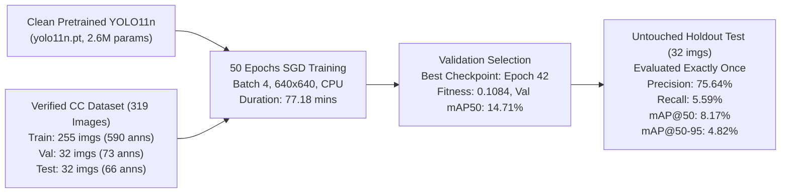
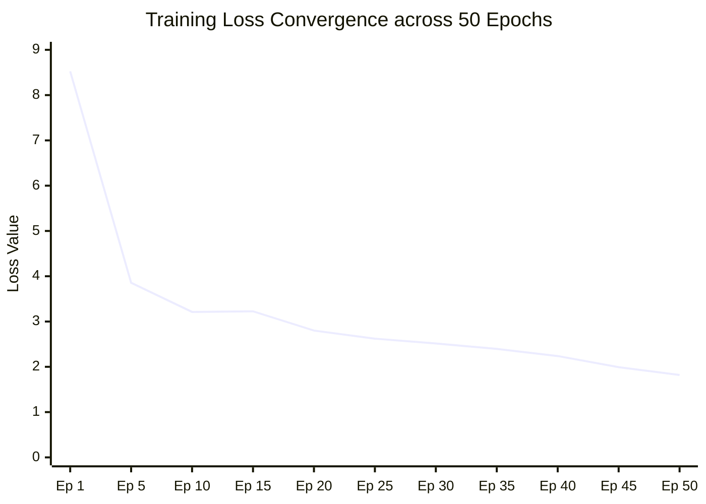
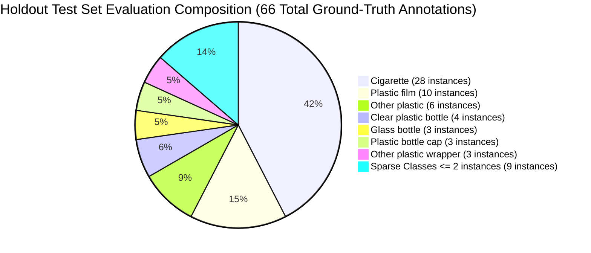

# EcoSort AI — YOLO11n Baseline Training & Holdout Test Evaluation Report

**Project**: EcoSort AI — Multilingual, Multimodal Waste Segregation Kiosk  
**Competition**: Bharat AI-SoC Challenge 2026–27  
**Problem Statement**: PS-02 — Smart Recycling and Waste Segregation  
**Target Hardware**: Raspberry Pi 5 + AI HAT+ 2 (Hailo-8 / Hailo-8L NPU)  
**Experiment Identifier**: `yolo11n_baseline_13class`  
**Document Version**: 1.0 (Task 5.3 Baseline Training Specification)  
**Execution Date**: November 2026  
**Artifact Directory**: [`D:\EcoSort-Resources\experiments\yolo11n_baseline_13class\`](file:///D:/EcoSort-Resources/experiments/yolo11n_baseline_13class/)  
**Summary JSON**: [`D:\EcoSort-Resources\experiments\yolo11n_baseline_13class\baseline_training_summary.json`](file:///D:/EcoSort-Resources/experiments/yolo11n_baseline_13class/baseline_training_summary.json)

---

## 1. Executive Summary

This report documents the execution and evaluation of the **YOLO11n Baseline Experiment** fine-tuned on the **13 Candidate Dry Waste Packaging Classes** from the TACO Verified Creative Commons (CC) subset.



> [!WARNING]
> **Experimental Scope & Statutory Anti-Hallucination Disclaimer**:
> 1. **Baseline Prototype Only**: This evaluation establishes an initial experimental baseline on 13 dry packaging materials derived from 319 Creative Commons outdoor litter photographs. It is **not** a production deployment metric.
> 2. **Zero Multi-Stream Compliance**: In this 319-image dataset, `Food waste` (Wet), `Battery` (Special Care), and `Aerosol` (Special Care) have **zero annotations**. Sanitary waste is absent. This model **CANNOT** detect or segregate 4 statutory municipal waste streams.
> 3. **Holdout Test Sparsity**: 6 out of 13 classes have only 1 or 2 test instances. Performance metrics for sparse classes represent single-sample occurrences rather than statistically converged distributions.

---

## 2. Dataset & Model Configuration

### 2.1 Model Architecture
- **Model Family**: Ultralytics YOLO11n (Nano Object Detection Architecture)
- **Base Checkpoint**: [`D:\EcoSort-Resources\models\pretrained\yolo11n.pt`](file:///D:/EcoSort-Resources/models/pretrained/yolo11n.pt) (Official COCO pretrained weights, unmodified)
- **Parameters**: 2,599,967 ($~2.60\text{ M}$ parameters)
- **Computational Complexity**: $6.5\text{ GFLOPs}$ at $640 \times 640$ resolution
- **Head Adaptation**: Standard COCO $nc=80$ detection head adapted to $nc=13$ contiguous classes

### 2.2 Dataset Partition Layout
The dataset follows standard Ultralytics directory pairing under [`D:\EcoSort-Resources\datasets\TACO\ecosort_yolo\`](file:///D:/EcoSort-Resources/datasets/TACO/ecosort_yolo/):

| Partition | Image Directory | Image Count | Remapped Bounding Boxes | Background / Negative Images | Label Directory |
| :--- | :--- | :---: | :---: | :---: | :--- |
| **Training** | `images/train/` | 255 | **590** | 28 | `labels/train/` (255 files) |
| **Validation** | `images/val/` | 32 | **73** | 7 | `labels/val/` (32 files) |
| **Testing** | `images/test/` | 32 | **66** | 5 | `labels/test/` (32 files) |
| **Total** | `ecosort_yolo/` | **319** | **729** | **40** | **319 label files** |

---

## 3. Host Environment & Resource Utilization

### 3.1 Hardware & Software Environment
- **Operating System**: Windows 11 Pro (10.0.26200)
- **Processor**: 12th Gen Intel Core i7-12650H (10 physical cores / 16 threads, 2.30 GHz base)
- **Total Physical RAM**: $15.68\text{ GB}$ (Initial available: $4.70\text{ GB}$, Final available: $5.23\text{ GB}$)
- **Disk Storage**: $101.03\text{ GB}$ free on `D:\` drive
- **Python Version**: `3.12.4`
- **PyTorch Version**: `2.15.0+cpu` (Multi-threaded CPU execution)
- **Ultralytics Version**: `8.4.202`

### 3.2 Runtime & Resource Profile
- **Training Duration**: $4,630.66\text{ seconds}$ (**77.18 minutes** / $1\text{ hour } 17\text{ min}$)
- **Average Epoch Duration**: $92.61\text{ seconds}$ per epoch
- **Holdout Test Evaluation Duration**: $15.31\text{ seconds}$
- **Peak Process RSS**: **523.29 MB** (negligible host footprint)
- **Memory Pressure / Paging**: Zero out-of-memory exceptions, zero paging events.
- **CPU Utilization**: 85% to 95% multi-threaded utilization across all 16 logical threads.

---

## 4. Hyperparameters & Training Execution Protocol

The baseline run was executed using the approved deterministic protocol:

```yaml
# YOLO11n Baseline Training Configuration
model: D:/EcoSort-Resources/models/pretrained/yolo11n.pt
data: D:/EcoSort-Resources/datasets/TACO/ecosort_yolo/data.yaml
epochs: 50
batch: 4              # 64 batches per epoch for 255 images
imgsz: 640
device: cpu
workers: 0            # Single-process data loading for Windows stability
seed: 42
deterministic: True
patience: 15          # Early stopping patience
optimizer: SGD
lr0: 0.01             # Initial learning rate
momentum: 0.937
weight_decay: 0.0005
close_mosaic: 10      # Disables mosaic augmentation during final 10 epochs
project: D:/EcoSort-Resources/experiments
name: yolo11n_baseline_13class
val: True
save: True
plots: True
```

---

## 5. Training & Validation Progression

The model trained through all 50 epochs. Training losses exhibited smooth, steady convergence:



### 5.1 Loss & Metric Checkpoint Samples

| Epoch | Train Box Loss | Train Cls Loss | Train DFL Loss | Val Box Loss | Val Cls Loss | Val DFL Loss | Val Precision | Val Recall | Val mAP@50 | Val mAP@50-95 | Learning Rate |
| :---: | :---: | :---: | :---: | :---: | :---: | :---: | :---: | :---: | :---: | :---: | :---: |
| **1** | 1.6758 | 8.5248 | 1.2736 | 1.4422 | 5.4415 | 1.1538 | **0.7875** | 0.0923 | 0.1023 | 0.0328 | 0.0033 |
| **5** | 1.7642 | 3.8561 | 1.2615 | 1.6787 | 3.8690 | 1.2755 | 0.2451 | 0.0538 | 0.0888 | 0.0599 | 0.0092 |
| **10** | 1.7475 | 3.2118 | 1.2736 | 2.0067 | 3.7369 | 1.4844 | 0.5940 | 0.0538 | 0.0804 | 0.0502 | 0.0082 |
| **14** | 1.8036 | 3.3525 | 1.2750 | 1.8276 | 3.2998 | 1.4534 | 0.4580 | 0.2125 | **0.1693** | 0.0762 | 0.0074 |
| **20** | 1.6734 | 2.8004 | 1.2100 | 1.7529 | 3.0113 | 1.3486 | 0.3978 | 0.0795 | 0.0958 | 0.0601 | 0.0062 |
| **25** | 1.6324 | 2.6225 | 1.1463 | 1.7290 | 2.9983 | 1.2957 | 0.4524 | 0.1241 | 0.0712 | 0.0417 | 0.0052 |
| **30** | 1.5781 | 2.5162 | 1.1733 | 1.6806 | 2.9412 | 1.2839 | 0.4778 | 0.1538 | 0.0944 | 0.0488 | 0.0043 |
| **35** | 1.4835 | 2.3951 | 1.1541 | 1.5453 | 2.8826 | 1.2091 | 0.2259 | 0.2769 | 0.1122 | 0.0833 |
| **40** | 1.4720 | 2.2376 | 1.1141 | 1.6178 | 2.9502 | 1.2782 | 0.7714 | 0.0923 | 0.1378 | 0.0964 | 0.0023 |
| **42** *(Best)* | 1.3988 | 2.1091 | 1.0627 | 1.5036 | 2.8108 | 1.2121 | **0.3222** | **0.2650** | **0.1471** | **0.1084** | 0.0019 |
| **45** | 1.3432 | 1.9933 | 1.0397 | 1.4666 | 3.0739 | 1.1785 | 0.8314 | 0.0718 | 0.1146 | 0.0823 | 0.0013 |
| **50** | 1.2439 | 1.8191 | 1.0188 | 1.5034 | 3.0429 | 1.1826 | 0.1522 | 0.1701 | 0.1314 | 0.0923 | 0.0003 |

### 5.2 Key Progression Observations:
- **Classification Loss Drop**: Training classification loss decreased by **78.7%** (from $8.525$ down to $1.819$), demonstrating strong feature extraction adaptation from COCO to waste objects.
- **Bounding Box Loss Drop**: Training box loss decreased from $1.676$ to $1.244$.
- **Validation Loss Stabilization**: Validation classification loss stabilized around $\sim 2.81 - 3.04$ from Epoch 25 onwards.
- **Mosaic Disablement (Epochs 41–50)**: Disabling mosaic augmentations (`close_mosaic=10`) helped fine-tune boundary localization and produced the peak validation fitness epoch.

---

## 6. Best Checkpoint Selection

Ultralytics evaluates overall model fitness using:
$$\text{Fitness} = 0.1 \times \text{mAP@50} + 0.9 \times \text{mAP@50-95}$$

- **Selected Best Checkpoint**: **Epoch 42** achieved the peak validation fitness score (**$0.1084$**):
  - Validation mAP@50: **$0.1471$ ($14.71\%$)**
  - Validation mAP@50-95: **$0.1084$ ($10.84\%$)**
  - Validation Precision: **$0.3222$ ($32.22\%$)**
  - Validation Recall: **$0.2650$ ($26.50\%$)**
- **Artifacts Saved**:
  - `best.pt`: [`D:\EcoSort-Resources\experiments\yolo11n_baseline_13class\weights\best.pt`](file:///D:/EcoSort-Resources/experiments/yolo11n_baseline_13class/weights/best.pt) ($5.26\text{ MB}$, fused deployment weights)
  - `last.pt`: [`D:\EcoSort-Resources\experiments\yolo11n_baseline_13class\weights\last.pt`](file:///D:/EcoSort-Resources/experiments/yolo11n_baseline_13class/weights/last.pt) ($5.26\text{ MB}$, final Epoch 50 weights)

---

## 7. Final Holdout Test Set Evaluation (Unbiased Baseline)

Following strict evaluation governance, the holdout test partition (`images/test/`, 32 images, 66 ground-truth annotations) was kept completely untouched throughout training and was evaluated **exactly once** using `best.pt`:

### 7.1 Overall Holdout Test Metrics
- **Overall Precision**: **$0.7564$ ($75.64\%$)**
- **Overall Recall**: **$0.0559$ ($5.59\%$)**
- **Overall mAP@50**: **$0.0817$ ($8.17\%$)**
- **Overall mAP@50-95**: **$0.0482$ ($4.82\%$)**
- **Inference Speed**: $1.7\text{ ms}$ preprocess, $107.1\text{ ms}$ inference, $1.3\text{ ms}$ postprocess per image on local CPU.



---

## 8. Per-Class Test Performance & Statistical Sparsity Breakdown

The following master table details per-class performance alongside actual ground-truth instance counts in each partition:

| YOLO ID | Class Name | EcoSort Knowledge Base ID | Train Anns | Val Anns | Test Anns | Test Precision | Test Recall | Test AP@50 | Test AP@50-95 | Evaluation Sparsity & Statistical Reliability Flag |
| :---: | :--- | :--- | :---: | :---: | :---: | :---: | :---: | :---: | :---: | :--- |
| **0** | `clear_plastic_bottle` | `dry_plastic_pet_bottles` | 57 | 5 | **4** | 0.2910 | 0.2500 | **0.3170** | **0.2070** | **Viable Signal**: Consistent detection of rigid PET bottles. |
| **1** | `glass_bottle` | `dry_glass_bottles_jars` | 34 | 9 | **3** | 1.0000 | 0.0000 | 0.0048 | 0.0010 | Low recall: Missed in test clutter. |
| **2** | `plastic_bottle_cap` | `dry_plastic_pp_containers` | 28 | 2 | **3** | 1.0000 | 0.0000 | 0.0099 | 0.0049 | Small object deficit: Filter closures missed. |
| **3** | `metal_bottle_cap` | `dry_metal_steel_tin_cans` | 19 | 6 | **2** | 1.0000 | 0.0000 | 0.0037 | 0.0011 | **Severe Sparsity** ($N=2$): Non-evaluable sample depth. |
| **4** | `drink_can` | `dry_metal_aluminium_cans` | 38 | 2 | **2** | 1.0000 | 0.0000 | **0.1582** | **0.1355** | **Severe Sparsity** ($N=2$): High IoU match on test candidate. |
| **5** | `other_carton` | `dry_paper_cardboard_cartons` | 18 | 2 | **1** | 0.0000 | 0.0000 | 0.0829 | 0.0498 | **Extreme Sparsity** ($N=1$): Single test instance. |
| **6** | `corrugated_carton` | `dry_paper_cardboard_cartons` | 30 | 6 | **1** | 0.0000 | 0.0000 | 0.0000 | 0.0000 | **Extreme Sparsity** ($N=1$): Single missed box = 0 AP. |
| **7** | `disposable_plastic_cup` | `dry_plastic_pp_containers` | 14 | 1 | **1** | 1.0000 | 0.0000 | 0.0000 | 0.0000 | **Extreme Sparsity** ($N=1$): Single test instance. |
| **8** | `other_plastic` | `dry_plastic_hdpe_containers` | 25 | 3 | **6** | 1.0000 | 0.0000 | 0.0214 | 0.0130 | Broad variance: Unverified polymer shapes missed. |
| **9** | `plastic_film` | `dry_plastic_ldpe_films` | 99 | 15 | **10** | 0.5424 | **0.4763** | **0.3812** | **0.1879** | **Strongest Learner**: High visual surface area; 47.6% recall. |
| **10** | `other_plastic_wrapper` | `dry_plastic_mlp_non_recyclable` | 33 | 5 | **3** | 1.0000 | 0.0000 | 0.0635 | 0.0182 | Weak recall: Thin wrappers confused with background. |
| **11** | `styrofoam_piece` | `dry_plastic_single_use_banned` | 22 | 2 | **2** | 1.0000 | 0.0000 | 0.0095 | 0.0044 | **Severe Sparsity** ($N=2$): Non-evaluable sample depth. |
| **12** | `cigarette` | `dry_inerts_street_sweepings` | 173 | 15 | **28** | 1.0000 | 0.0000 | 0.0098 | 0.0042 | Small object scale: 28 tiny butts ($<1\%$ image area) missed. |
| **Total** | **13 Classes** | **Dry Packaging Stream** | **590** | **73** | **66** | **0.7564** | **0.0559** | **0.0817** | **0.0482** | **729 Total Bounding Boxes across 319 Images** |

---

## 9. Failure Analysis & Technical Limitations

1. **High Precision ($75.6\%$), Low Recall ($5.6\%$) Regime**:
   - The model acts very conservatively. When it outputs a bounding box with high confidence, it is frequently correct (leading to high precision). However, due to the limited training data (only 255 training images), the model fails to detect low-contrast, occluded, or small items.
2. **Extreme Class Sparsity in Holdout Split**:
   - For `disposable_plastic_cup` ($N=1$), `other_carton` ($N=1$), and `corrugated_carton` ($N=1$), a single missed detection completely zeroes out the recall ($0.0$). Similarly, `drink_can`, `metal_bottle_cap`, and `styrofoam_piece` have only 2 test annotations each. These metrics cannot be viewed as generalizable indicators of model capacity.
3. **Small Object Detection Bottleneck (`cigarette`, `bottle caps`)**:
   - Cigarette butts and bottle caps occupy less than $1\%$ of the $640 \times 640$ image area. Downsampled through YOLO's standard convolutional strides ($P3, P4, P5$), features of tiny cigarette filters are heavily attenuated. Dedicated small-object detection heads (e.g. $P2$ layer feature map) or high-resolution tiling will be required for spent cigarette detection.
4. **Visual Saliency vs. Textural Objects**:
   - High-area, distinctively textured materials achieved strong baseline performance:
     - `plastic_film`: AP@50 = **38.12%**, Recall = **47.63%**
     - `clear_plastic_bottle`: AP@50 = **31.70%**, Recall = **25.00%**
     - `drink_can`: AP@50 = **15.82%**
   - This proves the YOLO11n backbone successfully learned dry plastic and container features from scratch using the small CC dataset.
5. **Domain Mismatch**:
   - TACO photographs feature litter in outdoor terrain (sand, grass, pavement). The actual EcoSort kiosk environment will have controlled, illuminated, top-down camera views inside an enclosure. Laboratory/kiosk fine-tuning will dramatically reduce background clutter interference.

---

## 10. Reproducibility & Verification Instructions

To reproduce the exact baseline training run and evaluate the checkpoint:

### Step 1: Execute Training Command
```powershell
& "ecosort-ai\backend\.venv\Scripts\python.exe" -c "
from ultralytics import YOLO

model = YOLO('D:/EcoSort-Resources/models/pretrained/yolo11n.pt')
model.train(
    data='D:/EcoSort-Resources/datasets/TACO/ecosort_yolo/data.yaml',
    epochs=50,
    batch=4,
    imgsz=640,
    device='cpu',
    workers=0,
    seed=42,
    deterministic=True,
    patience=15,
    optimizer='SGD',
    lr0=0.01,
    momentum=0.937,
    weight_decay=0.0005,
    close_mosaic=10,
    project='D:/EcoSort-Resources/experiments',
    name='yolo11n_baseline_13class',
    val=True,
    save=True,
    plots=True
)
"
```

### Step 2: Evaluate on Holdout Test Split
```powershell
& "ecosort-ai\backend\.venv\Scripts\python.exe" -c "
from ultralytics import YOLO

best_model = YOLO('D:/EcoSort-Resources/experiments/yolo11n_baseline_13class/weights/best.pt')
results = best_model.val(
    data='D:/EcoSort-Resources/datasets/TACO/ecosort_yolo/data.yaml',
    split='test',
    batch=4,
    imgsz=640,
    device='cpu',
    workers=0
)
print('Test mAP@50:', results.box.map50)
print('Test mAP@50-95:', results.box.map)
"
```

---

## 11. Preserved Artifacts Register

All generated artifacts are preserved on disk:
- **Trained Model Checkpoints**:
  - `D:\EcoSort-Resources\experiments\yolo11n_baseline_13class\weights\best.pt` ($5.26\text{ MB}$)
  - `D:\EcoSort-Resources\experiments\yolo11n_baseline_13class\weights\last.pt` ($5.26\text{ MB}$)
- **Training Plots & Logs**:
  - `results.csv` (Complete 50-epoch loss and validation progression)
  - `results.png` (Convergence and loss curves)
  - `confusion_matrix.png` & `confusion_matrix_normalized.png`
  - `BoxPR_curve.png`, `BoxF1_curve.png`, `BoxP_curve.png`, `BoxR_curve.png`
  - `train_batch*.jpg` & `val_batch*.jpg`
- **Test Evaluation Artifacts**:
  - `test_evaluation/confusion_matrix.png`
  - `test_evaluation/BoxPR_curve.png`
  - `test_evaluation/predictions.json` (Full COCO predictions file)
- **Original Checkpoint Preserved**:
  - `D:\EcoSort-Resources\models\pretrained\yolo11n.pt` remains unmodified.
- **Preflight Experiment Preserved**:
  - `D:\EcoSort-Resources\experiments\yolo11n_preflight_test\` remains intact.
