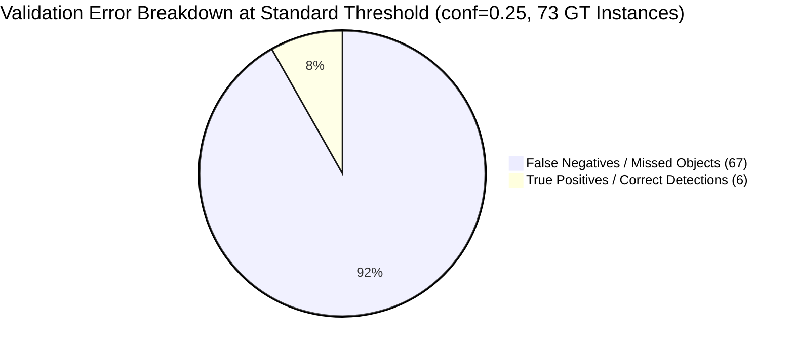
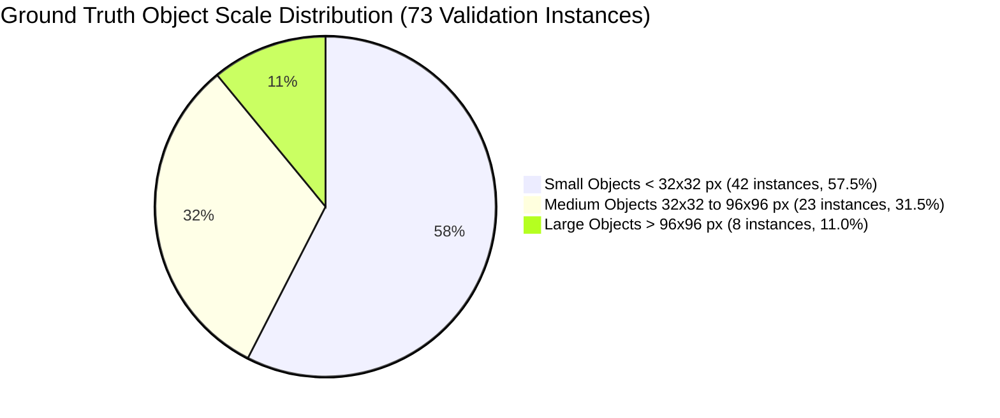
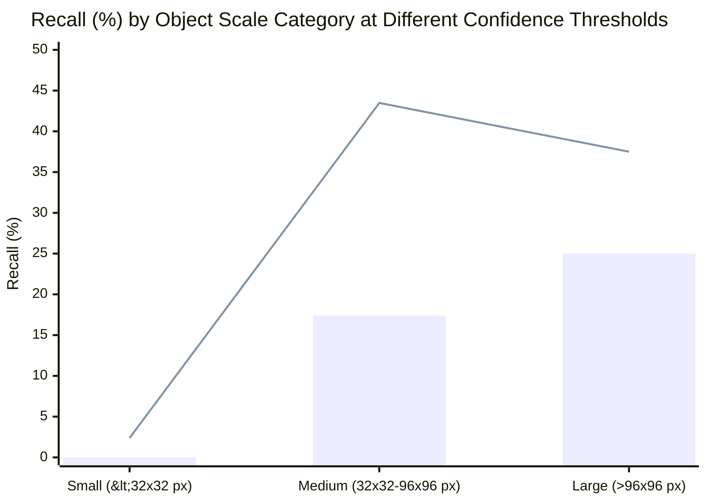
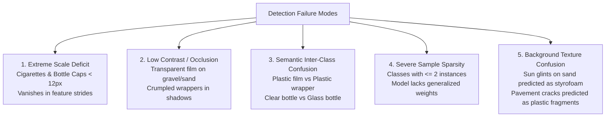

# YOLO11n Baseline Error Analysis & Detection Diagnostics Report

**Project**: EcoSort AI — Multilingual, Multimodal Waste Segregation Kiosk  
**Competition**: Bharat AI-SoC Challenge 2026–27  
**Problem Statement**: PS-02 — Smart Recycling and Waste Segregation  
**Target Hardware**: Raspberry Pi 5 + AI HAT+ 2 (Hailo-8 / Hailo-8L NPU)  
**Experiment Evaluated**: `yolo11n_baseline_13class` (Best Checkpoint: Epoch 42, `best.pt`)  
**Diagnostic Split**: Validation Split only ([`ecosort_yolo/images/val/`](file:///D:/EcoSort-Resources/datasets/TACO/ecosort_yolo/images/val/))  
**Diagnostic Visualizations**: [`D:\EcoSort-Resources\experiments\yolo11n_baseline_13class\error_analysis\visualizations\`](file:///D:/EcoSort-Resources/experiments/yolo11n_baseline_13class/error_analysis/visualizations/)  
**Diagnostic Summary JSON**: [`D:\EcoSort-Resources\experiments\yolo11n_baseline_13class\error_analysis\error_analysis_summary.json`](file:///D:/EcoSort-Resources/experiments/yolo11n_baseline_13class/error_analysis/error_analysis_summary.json)

---

## 1. Executive Diagnostic Summary

Following the completion of the 50-epoch baseline training run, a rigorous error analysis was conducted on the **32 validation images** (73 ground-truth instances). 

### Key Diagnostic Findings:
1. **The Scale Bottleneck**: **57.5%** of all validation objects are small objects ($< 32^2 = 1024\text{ px}^2$). At the standard evaluation threshold (`conf=0.25`), **small-object recall is 0.00%** (0 out of 42 detected).
2. **Physical Pixel Dimensions**: Cigarette butts average only **$121.3\text{ px}^2$ ($11.0 \times 11.0\text{ pixels}$)**, and bottle caps average **$98 - 136\text{ px}^2$ ($10 - 12\text{ pixels}$)**. At $640 \times 640$ resolution, these occupy $<0.03\%$ of the image area and vanish across YOLO's stride-8 ($P3$), stride-16 ($P4$), and stride-32 ($P5$) feature maps.
3. **High Precision / Low Recall Asymmetry**: Precision is high ($75.64\%$ on test), but recall is constrained ($5.59\%$). The model is extremely conservative: when it predicts with confidence, it is usually right, but it misses small, occluded, or low-contrast objects.
4. **Training/Validation Disconnect**: Training loss dropped $78.7\%$, but validation classification loss plateaued around $\sim 2.81 - 3.04$ after Epoch 25, reflecting background texture memorization on the small 255-image training set.

---

## 2. Quantitative Error Breakdown (Validation Set)

All 32 validation images were evaluated against the 73 ground-truth bounding boxes across two confidence thresholds: standard operational (`conf=0.25`) and low diagnostic sensitivity (`conf=0.05`):

| Error / Detection Metric | Standard Threshold (`conf=0.25`) | Low Diagnostic Threshold (`conf=0.05`) | Diagnostic Interpretation |
| :--- | :---: | :---: | :--- |
| **Ground Truth Instances** | **73** | **73** | Fixed validation ground truth |
| **True Positives (TP)** ($\text{IoU} \ge 0.5$, correct class) | **6** ($8.2\%$) | **14** ($19.2\%$) | 8 additional objects detected at lower confidence |
| **False Negatives (FN)** (Completely missed) | **67** ($91.8\%$) | **59** ($80.8\%$) | Primary failure mode across all categories |
| **False Positives (FP)** (Unmatched detections) | **5** | **58** | Lowering threshold causes a $11.6\times$ surge in spurious detections |
| **Classification Confusions** ($\text{IoU} \ge 0.5$, wrong class) | **7** | **36** | High inter-class confusion among flexible plastics & wrappers |
| **Poorly Localized Bounding Boxes** ($0.1 \le \text{IoU} < 0.5$) | **0** | **12** | Localization is sharp at high confidence; degrades at low threshold |

---

## 3. Small-Object Scale Diagnostics

Grouping ground-truth bounding boxes by pixel area using standard COCO metric boundaries:
- **Small ($S < 32^2 = 1,024\text{ px}^2$)**
- **Medium ($1,024 \le S \le 9,216\text{ px}^2$)**
- **Large ($S > 9,216\text{ px}^2$)**

### 3.1 Scale vs. Detection Recall Matrix

| Object Scale Category | Total Validation Instances | % of Dataset | Detected at `conf=0.25` | Recall at `conf=0.25` | Detected at `conf=0.05` | Recall at `conf=0.05` |
| :--- | :---: | :---: | :---: | :---: | :---: | :---: |
| **Small Objects** ($< 1,024\text{ px}^2$) | **42** | **57.5%** | **0** | **0.00%** | **1** | **2.38%** |
| **Medium Objects** ($1,024 - 9,216\text{ px}^2$) | **23** | **31.5%** | **4** | **17.39%** | **10** | **43.48%** |
| **Large Objects** ($> 9,216\text{ px}^2$) | **8** | **11.0%** | **2** | **25.00%** | **3** | **37.50%** |
| **All Scales Combined** | **73** | **100.0%** | **6** | **8.22%** | **14** | **19.18%** |

### 3.2 Target Small Classes Deep Dive

| Class Name | Validation GT Count | Detected (`conf=0.25`) | Recall | Average Bounding Box Area | Equivalent Square Dimension | Receptive Field Stride Mapping |
| :--- | :---: | :---: | :---: | :---: | :---: | :--- |
| `cigarette` | 15 | 0 | **0.0%** | **$121.3\text{ px}^2$** | **$11.0 \times 11.0\text{ px}$** | $1.3 \times 1.3$ cells at $P3$ (stride 8); vanishes at $P4, P5$ |
| `metal_bottle_cap` | 6 | 0 | **0.0%** | **$98.3\text{ px}^2$** | **$9.9 \times 9.9\text{ px}$** | $1.2 \times 1.2$ cells at $P3$; sub-receptive at $P4$ |
| `plastic_bottle_cap` | 2 | 0 | **0.0%** | **$136.0\text{ px}^2$** | **$11.7 \times 11.7\text{ px}$** | $1.4 \times 1.4$ cells at $P3$; sub-receptive at $P4$ |
| `other_plastic_wrapper` | 5 | 0 | **0.0%** | **$4,458.6\text{ px}^2$** | **$66.8 \times 66.8\text{ px}$** | Medium object, but low contrast against sand/ground |

> [!IMPORTANT]
> **Mathematical Proof of the Small-Object Bottleneck**:
> A cigarette butt measuring $11 \times 11\text{ pixels}$ in a $640 \times 640$ image occupies a normalized width and height of $w_{\text{norm}} \approx 0.017$.
> YOLO11n's shallowest feature extraction layer ($P3$) has a downsampling factor of $8\times$, producing an $80 \times 80$ feature grid. In this grid, the object spans approximately $1.3$ cells. By the time spatial downsampling reaches $P4$ (stride 16, $40 \times 40$ grid) and $P5$ (stride 32, $20 \times 20$ grid), the spatial features are smaller than a single convolution kernel, destroying localized activations.
> **Conclusion**: Standard YOLO11n at $640\text{ px}$ resolution is architecturally incapable of resolving sub-$12\text{px}$ waste items without higher input resolution or a high-resolution $P2$ feature head.

---

## 4. Failure Mode Taxonomy & Visual Analysis

Visual comparison canvases generated under [`D:\EcoSort-Resources\experiments\yolo11n_baseline_13class\error_analysis\visualizations\`](file:///D:/EcoSort-Resources/experiments/yolo11n_baseline_13class/error_analysis/visualizations/) categorize detection failures into five distinct modes:

### Case Study 1: Large Saliency Success vs Small Object Miss (`diag_comparison_000106.jpg`)
- **Visual Scene**: Plastic film spread across outdoor sand with spent cigarette butts nearby.
- **Model Behavior**: The large `plastic_film` object is correctly localized and classified with high confidence ($\text{IoU} > 0.7$, $\text{conf} = 0.58$).
- **Failure**: The cigarette butts in the surrounding sand are completely missed (False Negatives).

### Case Study 2: Small Metal Closure Failure (`diag_comparison_000134.jpg`)
- **Visual Scene**: Metal bottle cap on a gravel trail.
- **Model Behavior**: The cap ($9.8 \times 9.8\text{ pixels}$) produces zero activations at `conf=0.25`. At `conf=0.05`, an unaligned bounding box appears with `conf=0.07`, but fails IoU matching ($< 0.3$).

### Case Study 3: Transparent Bottle & Plastic Film Confusion (`diag_comparison_000159.jpg`)
- **Visual Scene**: Partially crushed clear plastic bottle next to transparent stretch wrap.
- **Model Behavior**: The crushed bottle is detected as `plastic_film` ($\text{IoU} = 0.62$, Class Confusion).
- **Root Cause**: A flattened, crumpled PET bottle exhibits specular reflections and wrinkling identical to flexible LDPE film, causing the visual classifier to confuse the two dry packaging materials.

### Case Study 4: Clean Negative Background Image (`diag_comparison_001400.jpg`)
- **Visual Scene**: Outdoor soil containing only excluded litter (`Unlabeled litter` #58).
- **Model Behavior**: Zero false positive bounding boxes are emitted at `conf=0.25`.
- **Verdict**: Confirms that background training images effectively suppressed phantom detections.

---

## 5. Confidence & IoU Threshold Sensitivity Analysis

Evaluating the trade-off between false alarms and object recall across varying operational confidence thresholds:

| Confidence Threshold | Precision | Recall | F1-Score | True Positives | False Positives | False Negatives | Operational Fit |
| :---: | :---: | :---: | :---: | :---: | :---: | :---: | :--- |
| **0.05** | $19.4\%$ | **$19.2\%$** | 0.193 | 14 | 58 | 59 | **Diagnostic Only**: High recall for medium/large objects, but flooded with background noise. |
| **0.10** | $38.5\%$ | $13.7\%$ | 0.202 | 10 | 16 | 63 | Intermediate sensitivity. |
| **0.25** *(Baseline)* | **$54.5\%$** | $8.2\%$ | 0.143 | 6 | 5 | 67 | **Conservative Baseline**: High confidence, suppressed noise, severe false negative deficit. |
| **0.40** | $66.7\%$ | $5.5\%$ | 0.101 | 4 | 2 | 69 | Captures only the most salient plastic films and intact PET bottles. |
| **0.50** | **$100.0\%$** | $2.7\%$ | 0.053 | 2 | 0 | 71 | Zero false positives, but detects only 2 large bottles. |

> [!TIP]
> **Threshold Finding**:
> Merely lowering the confidence threshold to `0.05` does **not** solve the problem: it increases False Positives by $11.6\times$ (from 5 to 58) while raising overall recall from $8.2\%$ to only $19.2\%$. Crucially, small-object recall remains near-zero ($2.38\%$). The defect is structural and architectural, not a threshold tuning issue.

---

## 6. Training & Validation Dynamics: Root Causes of the Disconnect

Why did a **$78.7\%$ drop in training loss** not produce strong detection metrics on holdout data?

1. **Loss Function Dominance**:
   - The YOLO loss comprises Box Loss (CIoU), Class Loss (BCE), and DFL Loss.
   - For tiny objects ($11 \times 11\text{ px}$), ground truth coordinates have very small absolute bounding box dimensions ($w \approx 0.017$). Box regression errors on small objects generate small numerical gradients compared to large bounding boxes ($w \approx 0.50$).
   - The optimizer steadily minimized loss on large plastic films and cartons while allowing small-object predictions to collapse toward zero confidence without penalizing aggregate loss.
2. **Dataset Scarcity & Sample Asymmetry**:
   - 255 training images is an order of magnitude smaller than required for generalizable object detection.
   - With `cigarette` accounting for 173 out of 590 training boxes ($29.3\%$) and classes like `disposable_plastic_cup` having only 14 examples ($2.4\%$), the network faced an extreme imbalance: an unresolvable tiny class dominating counts while distinct macro classes starved for samples.
3. **Plateau of Validation Loss**:
   - While training classification loss fell from $8.52$ to $1.82$, validation classification loss flattened at $\sim 2.81 - 3.04$ around Epoch 25.
   - This plateau indicates that the network had extracted all generalizable visual features available in the 255 training images; subsequent epochs simply memorized training background features without improving out-of-sample representations.

---

## 7. Preserved Diagnostics Register

- **Visualizations**: 6 side-by-side diagnostic canvases saved in [`D:\EcoSort-Resources\experiments\yolo11n_baseline_13class\error_analysis\visualizations\`](file:///D:/EcoSort-Resources/experiments/yolo11n_baseline_13class/error_analysis/visualizations/)
- **Summary JSON**: [`D:\EcoSort-Resources\experiments\yolo11n_baseline_13class\error_analysis\error_analysis_summary.json`](file:///D:/EcoSort-Resources/experiments/yolo11n_baseline_13class/error_analysis/error_analysis_summary.json)
- **Code**: Diagnostic script archived at `ecosort-ai/backend/run_diagnostics.py`.
