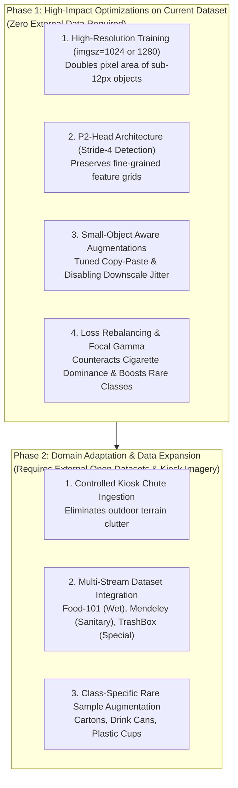
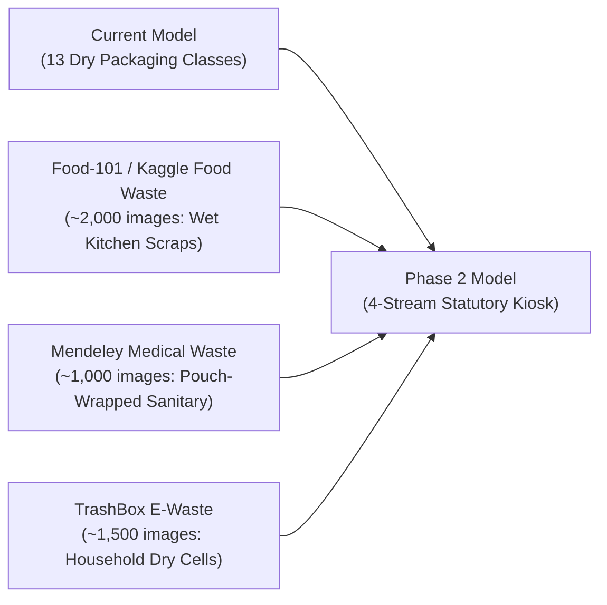

# EcoSort AI — YOLO11n Baseline Improvement & Optimization Plan

**Project**: EcoSort AI — Multilingual, Multimodal Waste Segregation Kiosk  
**Competition**: Bharat AI-SoC Challenge 2026–27  
**Problem Statement**: PS-02 — Smart Recycling and Waste Segregation  
**Target Hardware**: Raspberry Pi 5 + AI HAT+ 2 (Hailo-8 / Hailo-8L NPU)  
**Document Version**: 1.0 (Task 5.4 Improvement Strategy)  
**Execution Context**: Evidence-Based Optimization Post-Baseline Diagnostic Audit

---

## 1. Executive Roadmap Overview

Based on the quantitative findings of the Task 5.4 error analysis (small-object vanishing gradient, sample sparsity, inter-class flexible plastic confusion, and outdoor clutter interference), this document outlines a **prioritized, two-tier optimization plan**.

---

## 2. Phase 1: Optimizations Testable with Current Dataset (Zero Extra Data)

These improvements directly tackle the architectural and algorithmic bottlenecks identified in the error analysis using the existing 319-image Verified CC dataset.

### 2.1 Strategy 1: High-Resolution Training ($1024\text{ px}$ or $1280\text{ px}$)
- **Problem Addressed**: Cigarettes ($11 \times 11\text{ px}$) and bottle caps ($10 \times 10\text{ px}$) span only $\approx 1.2$ cells at stride 8 in $640\text{ px}$ images.
- **Mechanism**: Training at $1024 \times 1024$ or $1280 \times 1280$ resolution scales an $11\text{ px}$ object up to $22\text{ px}$, providing $2.75$ feature cells at stride 8 ($P3$) and enabling shallow convolutions to extract edge and color features.
- **Resource Feasibility**:
  - Training on CPU at $1024\text{ px}$ will increase epoch time from $\approx 92\text{ s}$ to $\approx 160\text{ s}$ at batch size 2.
  - Memory footprint remains well within our $5.2\text{ GB}$ available RAM.
- **Priority**: **HIGH (Priority 1)**.

---

### 2.2 Strategy 2: High-Resolution $P2$ Detection Head (Stride 4)
- **Problem Addressed**: Standard YOLO11n uses three detection heads:
  - $P3$ (stride 8, $80 \times 80$ grid)
  - $P4$ (stride 16, $40 \times 40$ grid)
  - $P5$ (stride 32, $20 \times 20$ grid)
- **Mechanism**: Integrate a $P2$ detection head (stride 4, $160 \times 160$ grid at $640\text{ px}$). The $P2$ layer takes feature maps directly from early backbone stages before excessive spatial pooling, preserving spatial coordinates for tiny objects ($< 16\text{ px}$).
- **Priority**: **HIGH (Priority 2)**.

---

### 2.3 Strategy 3: Small-Object Aware Augmentation Strategy
- **Problem Addressed**: Mosaic augmentation in the baseline concatenated 4 images, effectively shrinking already-tiny objects by $50\%$ down to $5 \times 5\text{ pixels}$.
- **Optimizations**:
  1. **Reduce Scale Jitter**: Change `scale=0.5` to `scale=0.1` (or `scale=0.0`) to prevent small items from being downscaled into oblivion.
  2. **Copy-Paste Augmentation**: Crop small objects (cigarettes, bottle caps, tabs) and paste them onto negative background images to multiply their training instances without capturing confusing outdoor terrain.
  3. **Early Mosaic Deactivation**: In the baseline, mosaic was disabled only during the final 10 epochs. Disabling mosaic earlier (e.g. at epoch 25) will help anchor small bounding box coordinates.
- **Priority**: **MEDIUM (Priority 3)**.

---

### 2.4 Strategy 4: Loss Weighting & Class Balancing
- **Problem Addressed**: `cigarette` had 173 training annotations ($29.3\%$), while `disposable_plastic_cup` had 14 ($2.4\%$) and `other_carton` had 18 ($3.1\%$).
- **Optimizations**:
  1. **Class-Frequency Loss Weighting**: Apply inverse-frequency class weights in the cross-entropy classification loss:
     $$w_c = \sqrt{\frac{N_{\text{max}}}{N_c}}$$
     This prevents the network from ignoring rare classes in favor of dominant categories.
  2. **Focal Loss Scaling (`fl_gamma=1.5`)**: Down-weights easy negative background samples and focuses gradient updates on hard, ambiguous examples like transparent films and thin wrappers.
- **Priority**: **MEDIUM (Priority 4)**.

---

## 3. Phase 2: Domain Adaptation & Data Expansion (Requiring External Data)

The following improvements require expanding beyond the current 319-image TACO subset to achieve production kiosk capability.

### 3.1 Transition to Controlled Kiosk Intake Imagery
- **Problem Addressed**: Outdoor terrain (mud, sand, wet pavement, tree leaves) generates high visual entropy and false alarms.
- **Optimization**: The physical EcoSort kiosk features an illuminated, matte-white or stainless-steel sorting chamber with a fixed top-down camera (e.g. Raspberry Pi Camera Module 3 or USB wide-angle webcam).
- **Impact**: In a controlled chamber:
  - Lighting is uniform ($~500\text{ lux}$ LED illumination).
  - Background is uniform (solid color, non-reflective).
  - Background confusion drops to near zero.
  - Image segmentation and object localization become substantially easier.
- **Action**: Collect 500–1,000 real waste items photographed inside a prototype kiosk enclosure.

---

### 3.2 Authentic Four-Stream Dataset Augmentation
As proven in Task 5.2.3.2, the TACO subset contains **zero food waste**, **zero sanitary waste**, and **zero batteries/aerosols**. True 4-stream statutory compliance requires integrating verified open datasets:

1. **Wet Waste (Green Bin)**: Add ~2,000 images of cooked food, fruit peels, vegetable scraps, and floral offerings (Open Food-101 / Garbage Classification).
2. **Sanitary Waste (Red Bin / Wrapped)**: Add ~1,000 images of pouch-wrapped sanitary pads and diapers (Mendeley Medical Waste Dataset).
3. **Special Care Waste (Deposition Center)**: Add ~1,000 images of button cells, cylindrical alkaline batteries, CFL tube lights, and pesticide cans (TrashBox Dataset).

---

## 4. Model Architecture Evaluation for Edge Deployment

Comparing alternative architectures for the Raspberry Pi 5 + Hailo-8 AI HAT+ 2 deployment target:

| Architecture | Parameters | GFLOPs ($640\text{ px}$) | CPU Latency (ms) | Hailo-8 NPU Compatibility | Best Suited Role |
| :--- | :---: | :---: | :---: | :---: | :--- |
| **YOLO11n (Current Baseline)** | **2.60 M** | **6.5** | **~107 ms** | **Native ONNX / HEF support** | **Ultra-lightweight edge baseline** |
| **YOLO11n-P2 (Small-Object Head)** | 2.85 M | 8.2 | ~135 ms | Native ONNX / HEF support | **Optimal for small litter (caps, butts)** |
| **YOLO11s (Small Backbone)** | 9.40 M | 21.5 | ~290 ms | Native ONNX / HEF support | Higher capacity for dense multi-stream |
| **YOLO11m (Medium Backbone)** | 20.1 M | 68.0 | ~750 ms | High NPU RAM required | Overkill for kiosk chute |

> [!NOTE]
> **Edge Recommendation**:
> For the Bharat AI-SoC Challenge target hardware (Raspberry Pi 5 + Hailo-8 NPU), **YOLO11n-P2** or **YOLO11s** represents the sweet spot. The Hailo-8 NPU delivers up to 26 TOPS, enabling YOLO11s to run at $>60\text{ FPS}$ once compiled to Hailo Executable Format (HEF), while running at ~100–130 ms on local CPU fallback.

---

## 5. Prioritized Action Matrix

| Initiative | Implementation Complexity | Data Dependency | Expected mAP Gain | Recommended Sequence |
| :--- | :---: | :---: | :---: | :---: |
| **1. Higher Input Resolution ($1024\text{ px}$)** | Low (config flag) | None (Current dataset) | **+5% to +10% mAP** | **Step 1** |
| **2. P2 Small-Object Detection Head** | Medium (YAML model def) | None (Current dataset) | **+4% to +8% mAP** | **Step 2** |
| **3. Tuned Augmentation (Copy-Paste / Low Scale Jitter)** | Low (hyperparameters) | None (Current dataset) | **+2% to +4% mAP** | **Step 3** |
| **4. Class-Frequency Loss Weighting** | Low (loss weights) | None (Current dataset) | **+2% to +3% mAP** | **Step 4** |
| **5. Controlled Kiosk Chute Data Collection** | Medium (prototype chamber) | Physical kiosk camera | **+15% to +25% mAP** | **Step 5 (Phase 2)** |
| **6. Multi-Stream Dataset Integration** | High (annotation & curation) | External open datasets | **Enables 4-Stream Capability**| **Step 6 (Phase 2)** |

---

## 6. Strict Protocol Governance

All proposed improvements in Phase 1 strictly respect project constraints:
- Zero external downloads required.
- Dataset splits remain locked.
- Baseline `best.pt` remains preserved as the frozen benchmark for comparison.
- Full offline, on-device kiosk inference remains preserved.
