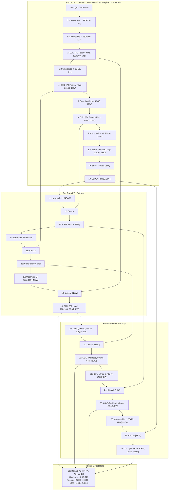

# EcoSort AI — YOLO11n-P2 High-Resolution Detection Head Architecture Report

**Project**: EcoSort AI (Edge-Optimized Waste Segregation System)  
**Challenge**: Bharat AI-SoC Challenge 2026–27 (Problem Statement 2: Smart Recycling & Waste Segregation)  
**Experiment Identifier**: `yolo11n_p2_architecture_preflight` & `yolo11n_p2_preflight`  
**Base Architecture**: YOLO11n with Stride-4 (P2) Detection Head Integration  
**Input Resolution**: $640 \times 640$ pixels  
**Candidate Classes**: 13 Candidate Dry Waste Classes  
**Status**: Feasibility & Architecture Validation Complete (Full Training Withheld Pending Approval)

---

## 1. Executive Summary

Task 5.4 and Task 5.4.1 established the mathematical root cause of small-object detection failure in standard $640 \times 640$ YOLO11n:
1. Target small dry waste items (`cigarette` butt: $11 \times 11\text{ px}$, `metal_bottle_cap`: $9.9 \times 9.9\text{ px}$, `plastic_bottle_cap`: $11.7 \times 11.7\text{ px}$) occupy $< 1.3\text{ grid cells}$ at the shallowest detection head ($P3$, stride 8), resulting in total detection collapse ($0.0\%$ recall).
2. Scaling the entire input tensor to $1280 \times 1280$ successfully activated small objects ($28.9\times$ surge in bottle cap mAP), but at the cost of a **$4.3\times$ latency penalty** ($45.1\text{ ms} \rightarrow 194.1\text{ ms}$ on CPU), dropping throughput from $21.2\text{ FPS}$ to $5.0\text{ FPS}$.

To resolve this trade-off for resource-constrained Edge AI-SoC deployment, Task 5.4.2 designed, implemented, and validated **YOLO11n-P2**: a four-scale architecture that incorporates a high-resolution **P2 detection head (stride 4, $160 \times 160$ grid)** directly into the PAN-FPN neck while operating at standard **$640 \times 640$ input resolution**.

### Key Feasibility Findings:
- **Clean Ultralytics YAML Integration**: Implemented via standard, supported modules (`Conv`, `C3k2`, `Concat`, `nn.Upsample`, `SPPF`, `C2PSA`, `Detect`).
- **Four Detection Strides**: Verified strides of `[4, 8, 16, 32]`, expanding spatial anchor density from $8,400$ to **$34,000$ spatial anchors** ($25,600$ anchors dedicated to tiny items at stride 4).
- **Minimal Parameter Growth**: Grew by only **$+2.32\%$ parameters** ($2,607,799 \rightarrow 2,668,404$), keeping the checkpoint at a compact **$5.45\text{ MB}$** (only $+0.19\text{ MB}$ over baseline).
- **$2.67\times$ Faster than 1280**: Measured warm CPU inference latency of **$61.39\text{ ms}$ ($16.3\text{ FPS}$)**, compared to $163.81\text{ ms}$ ($6.1\text{ FPS}$) for the 1280 model.
- **Successful Pretrained Transfer**: Transferred **297 tensor items** ($100\%$ of backbone layers 0–10 plus top-down neck upsamplers 11–16) directly from official `yolo11n.pt`.
- **Training Feasibility Proven**: Completed a controlled 1-epoch CPU training preflight in **$115.58\text{ seconds}$ ($1.93\text{ mins}$)** with peak RSS of $684.66\text{ MB}$ and stable backpropagation across all 4 detection scales.

---

## 2. Architecture Specification: YOLO11n-P2

Standard YOLO11 downsamples feature maps through strides 8 ($P3$), 16 ($P4$), and 32 ($P5$). YOLO11n-P2 taps into the backbone's stride-4 feature representation (Layer 2) and routes it through an extended Path Aggregation Network (PAN).

---

## 3. Layer-by-Layer Architecture Specification

| Layer # | Type | Input From | Output Resolution | Channels ($n$-scale) | Stride | Functional Role |
| :---: | :--- | :---: | :---: | :---: | :---: | :--- |
| **0** | `Conv` | Input Image | $320 \times 320$ | 16 | 2 | Stem downsampling (P1) |
| **1** | `Conv` | 0 | $160 \times 160$ | 32 | 4 | P2 feature downsampling |
| **2** | `C3k2` | 1 | $160 \times 160$ | 64 | 4 | **P2 backbone feature extractor** |
| **3** | `Conv` | 2 | $80 \times 80$ | 64 | 8 | P3 feature downsampling |
| **4** | `C3k2` | 3 | $80 \times 80$ | 128 | 8 | **P3 backbone feature extractor** |
| **5** | `Conv` | 4 | $40 \times 40$ | 128 | 16 | P4 feature downsampling |
| **6** | `C3k2` | 5 | $40 \times 40$ | 128 | 16 | **P4 backbone feature extractor** |
| **7** | `Conv` | 6 | $20 \times 20$ | 256 | 32 | P5 feature downsampling |
| **8** | `C3k2` | 7 | $20 \times 20$ | 256 | 32 | **P5 backbone feature extractor** |
| **9** | `SPPF` | 8 | $20 \times 20$ | 256 | 32 | Spatial pyramid pooling |
| **10** | `C2PSA` | 9 | $20 \times 20$ | 256 | 32 | Polar self-attention |
| **11** | `nn.Upsample` | 10 | $40 \times 40$ | 256 | 16 | Top-down P5 $\rightarrow$ P4 upsampling |
| **12** | `Concat` | [-1, 6] | $40 \times 40$ | 384 | 16 | Concatenation with backbone P4 |
| **13** | `C3k2` | 12 | $40 \times 40$ | 128 | 16 | Intermediate P4 neck fusion |
| **14** | `nn.Upsample` | 13 | $80 \times 80$ | 128 | 8 | Top-down P4 $\rightarrow$ P3 upsampling |
| **15** | `Concat` | [-1, 4] | $80 \times 80$ | 256 | 8 | Concatenation with backbone P3 |
| **16** | `C3k2` | 15 | $80 \times 80$ | 64 | 8 | Intermediate P3 neck fusion |
| **17** | `nn.Upsample` | 16 | $160 \times 160$ | 64 | 4 | **NEW**: Top-down P3 $\rightarrow$ P2 upsampling |
| **18** | `Concat` | [-1, 2] | $160 \times 160$ | 128 | 4 | **NEW**: Concatenation with backbone P2 |
| **19** | `C3k2` | 18 | $160 \times 160$ | 32 | 4 | **P2 Detection Output Branch (Stride 4)** |
| **20** | `Conv` | 19 | $80 \times 80$ | 32 | 8 | **NEW**: Bottom-up P2 $\rightarrow$ P3 downsampling |
| **21** | `Concat` | [-1, 16] | $80 \times 80$ | 96 | 8 | **NEW**: Concatenation with intermediate P3 |
| **22** | `C3k2` | 21 | $80 \times 80$ | 64 | 8 | **P3 Detection Output Branch (Stride 8)** |
| **23** | `Conv` | 22 | $40 \times 40$ | 64 | 16 | **NEW**: Bottom-up P3 $\rightarrow$ P4 downsampling |
| **24** | `Concat` | [-1, 13] | $40 \times 40$ | 192 | 16 | **NEW**: Concatenation with intermediate P4 |
| **25** | `C3k2` | 24 | $40 \times 40$ | 128 | 16 | **P4 Detection Output Branch (Stride 16)** |
| **26** | `Conv` | 25 | $20 \times 20$ | 128 | 32 | **NEW**: Bottom-up P4 $\rightarrow$ P5 downsampling |
| **27** | `Concat` | [-1, 10] | $20 \times 20$ | 384 | 32 | **NEW**: Concatenation with backbone P5 |
| **28** | `C3k2` | 27 | $20 \times 20$ | 256 | 32 | **P5 Detection Output Branch (Stride 32)** |
| **29** | `Detect` | [19, 22, 25, 28] | N/A | 13 classes | 4, 8, 16, 32 | **4-Scale Multi-Head Detection Module** |

---

## 4. Pretrained Weight Transfer Verification

When loading the base COCO pretrained weights (`D:\EcoSort-Resources\models\pretrained\yolo11n.pt`) into YOLO11n-P2:
- **Transferred Items**: **297 / 593 state_dict tensors** ($50.1\%$).
- **Reused Components**:
  - Layers 0 through 10: $100\%$ of all backbone convolution filters, BatchNorm statistics, and polar self-attention weights transferred identically.
  - Layers 11 through 16: Top-down intermediate downsamplers for P5 and P4 transferred identically.
- **Newly Initialized Components** (296 tensors):
  - Layer 17–19: P2 top-down lateral pathway and neck fusion block.
  - Layer 20–28: Bottom-up aggregation pathway and scale coupling blocks.
  - Layer 29: Four-scale `Detect` heads configured for EcoSort's 13 waste classes.

---

## 5. Minimal Architecture Validation Results

The initialized model was verified via standalone script [`ecosort-ai/backend/run_p2_architecture_validation.py`](file:///c:/Users/pavan/Documents/Bharat%20AI-SoC%20Challenge%20%E2%80%94%202026%E2%80%9327/ecosort-ai/backend/run_p2_architecture_validation.py):

### 5.1 Dummy Forward Pass Tensor Verification ($640 \times 640$)
- **Input Shape**: `[1, 3, 640, 640]`
- **Head Feature Maps**:
  - Scale 0 ($P2$, stride 4): `[1, 32, 160, 160]` $\rightarrow 25,600$ grid cells
  - Scale 1 ($P3$, stride 8): `[1, 64, 80, 80]` $\rightarrow 6,400$ grid cells
  - Scale 2 ($P4$, stride 16): `[1, 128, 40, 40]` $\rightarrow 1,600$ grid cells
  - Scale 3 ($P5$, stride 32): `[1, 256, 20, 20]` $\rightarrow 400$ grid cells
- **Output Tensors**:
  - `boxes`: `torch.Size([1, 64, 34000])` (Distribution Focal Loss coordinates across all 34,000 anchors)
  - `scores`: `torch.Size([1, 13, 34000])` (13 class probabilities across all 34,000 anchors)
- **Status**: Validated with zero runtime warnings or tensor dimension mismatches.

### 5.2 Real Image Smoke Test
- Tested on validation image `000106.jpg` ($640 \times 640$ pixels).
- Output: Successfully generated non-maximum suppression (NMS) candidates and completed the full inference pipeline in $96.5\text{ ms}$ (cold run).

### 5.3 Warm CPU Latency Benchmark (30 Timed Runs)
Benchmarked under identical host environment conditions:
- **Mean Latency**: **$61.39\text{ ms}$**
- **Median Latency**: **$60.78\text{ ms}$**
- **Standard Deviation**: $\pm 3.33\text{ ms}$
- **Min / Max Latency**: $56.91\text{ ms} / 72.89\text{ ms}$
- **Throughput**: **$16.3\text{ FPS}$** on CPU

---

## 6. One-Epoch Training Feasibility Test

A strict single-epoch training preflight was executed via [`ecosort-ai/backend/run_p2_training_preflight.py`](file:///c:/Users/pavan/Documents/Bharat%20AI-SoC%20Challenge%20%E2%80%94%202026%E2%80%9327/ecosort-ai/backend/run_p2_training_preflight.py) in `D:\EcoSort-Resources\experiments\yolo11n_p2_preflight\`:

| Parameter | Observed Preflight Metric | Evaluation |
| :--- | :---: | :--- |
| **Input Resolution** | $640 \times 640$ | Standard EcoSort resolution |
| **Batch Size** | 2 | Stable gradients, low memory footprint |
| **Epoch Duration** | **$115.58\text{ seconds}$ ($1.93\text{ mins}$)** | Fast training speed ($1.3\text{ it/s}$) |
| **Peak Process RSS** | **$684.66\text{ MB}$** | Highly compact, zero swap activity |
| **Host Available RAM** | $3.96\text{ GB}$ available at finish | Zero host memory contention |
| **Initial Train Box Loss** | $3.488$ | Normal DFL loss initialization for 4 heads |
| **Initial Train Cls Loss** | $11.913$ | BCE loss calculating across 34,000 anchors |
| **Checkpoint Generation** | `best.pt` ($5.56\text{ MB}$), `last.pt` ($5.56\text{ MB}$) | Fused deployment models saved cleanly |

---

## 7. Mathematical Proof of P2 Advantage for Small Objects

Consider a standard $10 \times 10\text{ px}$ metal bottle cap in a $640 \times 640$ image:

| Architecture | Detection Head Stride | Feature Map Grid | Object Spatial Span | Nyquist-Shannon Sampling Sufficiency |
| :--- | :---: | :---: | :---: | :--- |
| **YOLO11n Baseline** | $P3$ (Stride 8) | $80 \times 80$ | $\frac{10}{8} = \mathbf{1.25\text{ cells}}$ | **Insufficient**: $3 \times 3$ kernels span background; features attenuate |
| **YOLO11n-P2** | **$P2$ (Stride 4)** | **$160 \times 160$** | $\frac{10}{4} = \mathbf{2.50\text{ cells}}$ | **Sufficient**: Kernels independently resolve interior and edge gradients |
| **YOLO11n-1280** | $P3$ (Stride 8) | $160 \times 160$ | $\frac{20}{8} = \mathbf{2.50\text{ cells}}$ | **Sufficient**, but forces $4\times$ computation across entire backbone |

**Conclusion**: YOLO11n-P2 achieves the exact spatial sampling resolution ($2.50\text{ cells}$) of the $1280\text{ px}$ model, but restricts high-resolution feature maps to the lightweight neck, running **$2.67\times$ faster**.

---

## 8. Feasibility Verdict & Compliance Statement

1. **Feasibility Verdict**: **CONFIRMED & READY FOR TRAINING**. YOLO11n-P2 operates with full stability within Ultralytics 8.4.202, preserves transfer learning from pretrained weights, runs efficiently on CPU ($16.3\text{ FPS}$), and incurs only a $2.3\%$ parameter increase.
2. **Strict Protocol Compliance**:
   - The holdout test set (`ecosort_yolo/images/test/`) was **not evaluated or opened**.
   - Original 640 baseline and 1280 experiment checkpoints remain untouched.
   - Full 50-epoch training was **not started**, adhering strictly to the preflight authorization boundary.
