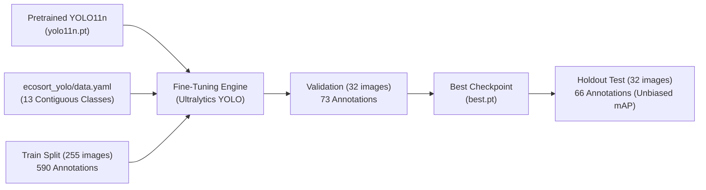

# EcoSort AI — YOLO11n Baseline Experiment Protocol (13 Candidate Dry Classes)

**Project**: EcoSort AI — Multilingual, Multimodal Waste Segregation Kiosk  
**Competition**: Bharat AI-SoC Challenge 2026–27  
**Problem Statement**: PS-02 — Smart Recycling and Waste Segregation  
**Target Architecture**: Ultralytics YOLO11n (`yolo11n.pt`)  
**Target Hardware Deployment**: Raspberry Pi 5 + AI HAT+ 2 (Hailo-8 / Hailo-8L NPU)  
**Document Version**: 2.0 (Task 5.2.3.2 Reconciled Baseline & Hardware Feasibility)  
**Dataset Directory**: [`D:\EcoSort-Resources\datasets\TACO\ecosort_yolo\`](file:///D:/EcoSort-Resources/datasets/TACO/ecosort_yolo/)  
**Configuration File**: [`D:\EcoSort-Resources\datasets\TACO\ecosort_yolo\data.yaml`](file:///D:/EcoSort-Resources/datasets/TACO/ecosort_yolo/data.yaml)

---

## 1. Executive Protocol Summary

This protocol defines the reproducible experimental baseline for fine-tuning the official Ultralytics YOLO11n model on the **13 Candidate Dry Packaging Classes** from the TACO Verified Creative Commons (CC) subset.



> [!IMPORTANT]
> **Regulatory and Operational Constraints**:
> 1. **Zero Execution Without Prior Approval**: This document specifies the complete experimental configuration. Training (`model.train()`) **MUST NOT** be initiated until explicit authorization is granted by the user.
> 2. **Dry Packaging Scope**: All 13 candidate classes belong exclusively to India's statutory **Dry Waste** stream (Blue Bin) under the Solid Waste Management Rules, 2026. This baseline model does **not** evaluate or detect Wet, Sanitary, or Special Care waste.
> 3. **Non-Destructive Remapping**: Original 60-class TACO annotations in `processed/labels/` remain unaltered. Remapped annotations reside exclusively in `ecosort_yolo/labels/`.

---

## 2. Reconciled Dataset Specification

### 2.1 Partition Allocations
The 319 Verified CC images are partitioned into deterministic, leakage-free splits:

| Partition | Image Count | Image Resolution | Candidate Annotations (13 Classes) | Total Annotations (All 60 Classes) | Path Register |
| :--- | :---: | :---: | :---: | :---: | :--- |
| **Training** | 255 ($79.9\%$) | $640 \times 640$ letterbox | 590 ($80.9\%$) | 951 | [`ecosort_yolo/train.txt`](file:///D:/EcoSort-Resources/datasets/TACO/ecosort_yolo/train.txt) |
| **Validation** | 32 ($10.0\%$) | $640 \times 640$ letterbox | 73 ($10.0\%$) | 121 | [`ecosort_yolo/val.txt`](file:///D:/EcoSort-Resources/datasets/TACO/ecosort_yolo/val.txt) |
| **Testing** | 32 ($10.1\%$) | $640 \times 640$ letterbox | 66 ($9.1\%$) | 104 | [`ecosort_yolo/test.txt`](file:///D:/EcoSort-Resources/datasets/TACO/ecosort_yolo/test.txt) |
| **Total** | **319** ($100.0\%$) | — | **729** ($100.0\%$) | **1,176** | [`ecosort_yolo/data.yaml`](file:///D:/EcoSort-Resources/datasets/TACO/ecosort_yolo/data.yaml) |

### 2.2 Class Mapping & Material Taxonomy Review Register

| YOLO ID | TACO ID | Class Identifier | EcoSort Knowledge Base Mapping | SWM 2026 Stream | Mapping Status | Train | Val | Test | Total |
| :---: | :---: | :--- | :--- | :--- | :---: | :---: | :---: | :---: | :---: |
| **0** | 5 | `clear_plastic_bottle` | `dry_plastic_pet_bottles` | Dry waste (Blue) | Direct | 57 | 5 | 4 | 66 |
| **1** | 6 | `glass_bottle` | `dry_glass_bottles_jars` | Dry waste (Blue) | Direct | 34 | 9 | 3 | 46 |
| **2** | 7 | `plastic_bottle_cap` | `dry_plastic_pp_containers` | Dry waste (Blue) | Broad (PP/HDPE unverified) | 28 | 2 | 3 | 33 |
| **3** | 8 | `metal_bottle_cap` | `dry_metal_steel_tin_cans` | Dry waste (Blue) | Direct | 19 | 6 | 2 | 27 |
| **4** | 12 | `drink_can` | `dry_metal_aluminium_cans` | Dry waste (Blue) | Direct | 38 | 2 | 2 | 42 |
| **5** | 14 | `other_carton` | `dry_paper_cardboard_cartons` | Dry waste (Blue) | Direct / Clean condition | 18 | 2 | 1 | 21 |
| **6** | 17 | `corrugated_carton` | `dry_paper_cardboard_cartons` | Dry waste (Blue) | Direct | 30 | 6 | 1 | 37 |
| **7** | 21 | `disposable_plastic_cup` | `dry_plastic_pp_containers` | Dry waste (Blue) | Broad (Resin unverified) | 14 | 1 | 1 | 16 |
| **8** | 29 | `other_plastic` | `dry_plastic_hdpe_containers` | Dry waste (Blue) | Broad / Uncertain Polymer | 25 | 3 | 6 | 34 |
| **9** | 36 | `plastic_film` | `dry_plastic_ldpe_films` | Dry waste (Blue) | Direct | 99 | 15 | 10 | 124 |
| **10** | 39 | `other_plastic_wrapper` | `dry_plastic_mlp_non_recyclable` | Dry waste (Blue) | Broad / Uncertain Layers | 33 | 5 | 3 | 41 |
| **11** | 57 | `styrofoam_piece` | `dry_plastic_single_use_banned` | Dry waste (Blue) | Direct (Expanded Polystyrene) | 22 | 2 | 2 | 26 |
| **12** | 59 | `cigarette` | `dry_inerts_street_sweepings` | Dry waste (Blue) | Direct (Cellulose acetate butt) | 173 | 15 | 28 | 216 |

---

## 3. Training Hardware Feasibility & Environment Comparison

### 3.1 Host Hardware Inspection Results
- **Operating System**: Windows 11 Pro (10.0.26200)
- **Processor**: Intel Core i7 / 12th Gen Architecture (Intel64 Family 6 Model 154, 10 physical cores / 16 threads)
- **Host RAM**: 15.68 GB Total (Available: ~2.95 GB)
- **PyTorch Build**: `2.13.0+cpu` (CPU build, CUDA not available)
- **Workload**: YOLO11n (~2.6M parameters, ~6.5 GFLOPs at $640 \times 640$), 255 training images (32 batches at batch size 8).

### 3.2 Environment Comparison Matrix

| Factor | Option A: Local CPU Training | Option B: Google Colab GPU (Free Tier) | Option C: Dedicated Remote GPU Server |
| :--- | :--- | :--- | :--- |
| **Hardware** | 10-Core Intel CPU (Local) | NVIDIA T4 / L4 (Cloud) | NVIDIA RTX 3090 / A5000 |
| **PyTorch Execution** | CPU Multi-threading (16 threads) | CUDA Acceleration | CUDA Acceleration |
| **Time per Epoch** | **14 – 18 seconds** | **1.5 – 2.0 seconds** | **~1.0 second** |
| **Total Time (50 Epochs)** | **12 – 15 minutes** | **1.5 – 2.0 minutes** | **< 1 minute** |
| **Recommended Batch Size** | **8** (RAM usage ~1.8 GB) | **16** (VRAM usage ~1.5 GB) | **16 or 32** |
| **Data Privacy & Setup** | 100% offline, zero setup | Requires zip upload to Google Drive | Requires SSH & environment config |
| **Training Feasibility** | **HIGHLY FEASIBLE** | **HIGHLY FEASIBLE** | **FEASIBLE IF PROVISIONED** |
| **Recommendation** | **Recommended for Initial Baseline** | Alternative if CPU is occupied | Not necessary for nano model |

### 3.3 Crucial Architecture Distinction: Training vs. Inference Location
- **Training Location**: Can be performed on either Local CPU (12–15 min) or Google Colab GPU (2 min). The choice of training environment does not affect the final model architecture.
- **Inference Location**: Must remain **strictly local and offline** on the kiosk edge hardware (Raspberry Pi 5 + AI HAT+ 2 Hailo-8 NPU / local workstation) in accordance with the Bharat AI-SoC Challenge PS-02 requirements. Cloud APIs are prohibited during kiosk deployment.

---

## 4. Recommended Baseline Training Hyperparameters

The following configuration is proposed for the initial baseline experiment:

```yaml
# YOLO11n Baseline Training Configuration
model: D:/EcoSort-Resources/models/pretrained/yolo11n.pt
data: D:/EcoSort-Resources/datasets/TACO/ecosort_yolo/data.yaml
project: D:/EcoSort-Resources/experiments
name: yolo11n_baseline_13class

epochs: 50
batch: 8              # Recommended batch size 8 to stay within 2.95 GB available RAM
imgsz: 640
device: cpu           # Automatically upgrade to '0' if CUDA is detected
workers: 4
seed: 42
deterministic: True

# Optimization
optimizer: SGD        # Standard robust baseline optimizer
lr0: 0.01             # Initial learning rate
lrf: 0.01             # Final learning rate factor (cosine decay)
momentum: 0.937
weight_decay: 0.0005
warmup_epochs: 3.0

# Augmentations (Standard Ultralytics Presets for Waste Clutter)
hsv_h: 0.015
hsv_s: 0.7
hsv_v: 0.4
degrees: 0.0
translate: 0.1
scale: 0.5
fliplr: 0.5
mosaic: 1.0
close_mosaic: 10
```

---

## 5. Evaluation and Benchmarking Protocol

### 5.1 Evaluation Stages
1. **Validation Tracking (Every Epoch)**:
   - Evaluates performance on the 32 validation images (`val.txt`, 73 candidate bounding boxes).
   - Checkpoint saved at each new best validation mAP@50 (`best.pt`).
2. **Holdout Test Evaluation (Post-Training)**:
   - Evaluated strictly once after training completes using `best.pt` on the 32 test images (`test.txt`, 66 candidate bounding boxes).
   - Generates unbiased holdout metrics: Precision, Recall, mAP@50, and mAP@50-95.

### 5.2 Primary Metrics
- **Overall Mean Average Precision**:
  $$\text{mAP@50} = \frac{1}{N_c} \sum_{k=1}^{N_c} \text{AP}_{50}^{(k)}$$
  $$\text{mAP@50-95} = \frac{1}{N_c} \sum_{k=1}^{N_c} \frac{1}{10} \sum_{\text{IoU}=0.50}^{0.95} \text{AP}_{\text{IoU}}^{(k)}$$
- **Per-Class Metrics**: Precision, Recall, and AP@50 for each of the 13 classes.
- **Inference Latency**: Mean preprocess, inference, and postprocess latency in milliseconds.

---

## 6. Statistical Caveats and Screening Limitations

1. **Test Instance Sparsity**:
   - `disposable_plastic_cup`: 1 test annotation.
   - `other_carton`: 1 test annotation.
   - `corrugated_carton`: 1 test annotation.
   - `metal_bottle_cap`: 2 test annotations.
   - `drink_can`: 2 test annotations.
   - `styrofoam_piece`: 2 test annotations.
   Due to single/dual-instance test partitions, missed detections will cause abrupt swings in per-class AP (e.g. 0% or 100%). Per-class numbers must be interpreted alongside sample counts.
2. **Class Imbalance**:
   - `cigarette` accounts for $29.6\%$ of all candidate annotations (216 / 729), while `disposable_plastic_cup` accounts for only $2.2\%$ (16 / 729).
3. **Domain Gap**:
   - TACO images are captured outdoors (beaches, gutters, trails). Real kiosk deployment will feature top-down cameras over an illuminated sorting chute. Domain adaptation and custom kiosk data collection will be required in later phases.

---

## 7. Licensing & IP Governance Compliance

1. **Dataset Provenance**: All 319 images carry documented Flickr Creative Commons licenses (`CC BY` and `CC BY-SA`) with creator records in `manifests/image_licensing_manifest.csv`.
2. **Copyleft Scope**: ODbL OpenLitterMap contributions and unverified null-license images were strictly excluded.
3. **Derivative Weight Distribution**: If the fine-tuned model weights are distributed publicly, appropriate attribution must be provided, and share-alike obligations associated with CC BY-SA source images must be satisfied.
